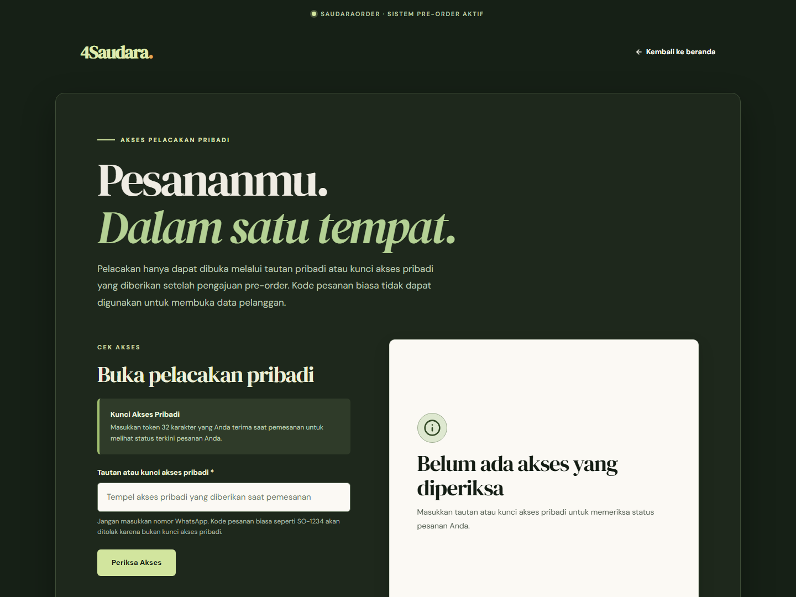
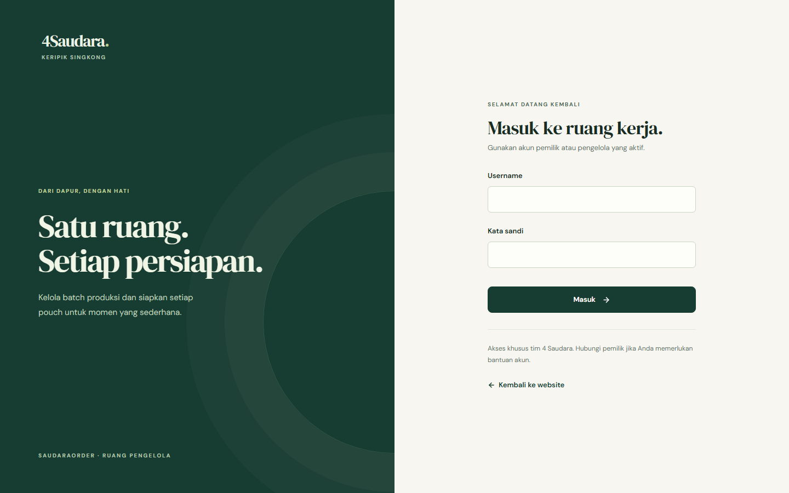
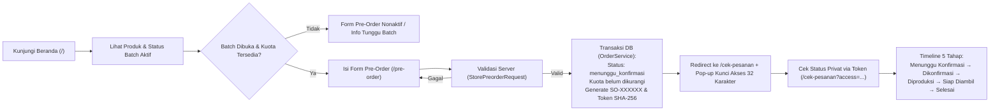
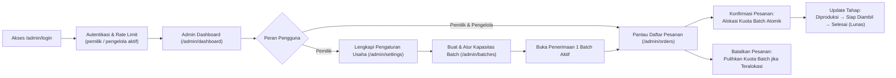
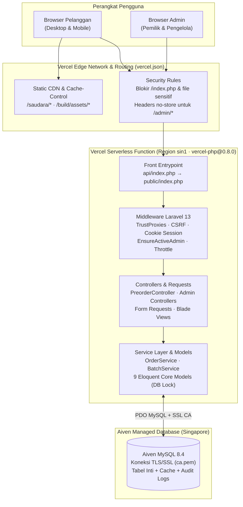

<div align="center">

# SaudaraOrder

**Sistem Informasi Pre-Order, Pengendalian Kuota Batch, dan Pelacakan Pesanan Privat**<br>
*Untuk UMKM Keripik Singkong 4 Saudara — Satu Produk, Satu Rasa Khas, Rp5.000/pouch.*

[](https://saudara-order.vercel.app)
[](https://laravel.com)
[](https://www.php.net)
[](https://aiven.io)
[](https://vite.dev)
[](https://tailwindcss.com)
[-1E5E3A?style=for-the-badge&logo=phpunit&logoColor=white)](phpunit.xml)

[Live Website](https://saudara-order.vercel.app) · [Dokumentasi Teknis](docs/ARCHITECTURE.md) · [PRD](docs/PRD.md) · [Panduan Screenshot](docs/screenshots/README.md)

</div>

---

## Ringkasan Proyek

**SaudaraOrder** adalah aplikasi web yang dirancang sebagai proyek *Capstone* untuk membantu usaha **Keripik Singkong 4 Saudara** memusatkan pemesanan pre-order, mengendalikan kuota produksi per batch agar tidak terjadi kelebihan alokasi (*overselling*), serta menyediakan pelacakan status pesanan secara privat tanpa mewajibkan pelanggan membuat akun.

Aplikasi ini menggabungkan antarmuka pelanggan dengan pendekatan *Warm Minimalist Editorial* dan ruang kerja pengelola berbasis peran (`pemilik` dan `pengelola`) yang dilindungi autentikasi session Laravel, transaksi database atomik (`lockForUpdate`), serta jejak audit (`audit_logs`).

---

## Daftar Isi

- [Tampilan Aplikasi (Project Showcase)](#tampilan-aplikasi-project-showcase)
- [Fitur Aplikasi](#fitur-aplikasi)
- [Alur Sistem (User Flow)](#alur-sistem-user-flow)
- [Arsitektur Sistem](#arsitektur-sistem)
- [Technology Stack](#technology-stack)
- [Struktur Proyek](#struktur-proyek)
- [Panduan Instalasi Lokal](#panduan-instalasi-lokal)
- [Pengujian & Kualitas Kode](#pengujian--kualitas-kode)
- [Project Roadmap](#project-roadmap)
- [Project Memory & Development History](#project-memory--development-history)
- [Dokumentasi Pendukung](#dokumentasi-pendukung)

---

## Tampilan Aplikasi (Project Showcase)

### A. Antarmuka Pelanggan (*Customer Interface*)

<table>
  <tr>
    <td width="50%" align="center">
      
      <br>
      <sub><b>1. Homepage / Landing Page (<code>/</code>)</b><br>Memperkenalkan identitas merek Keripik Singkong 4 Saudara, harga Rp5.000/pouch, informasi batch aktif, cara pesan, dan FAQ.</sub>
    </td>
    <td width="50%" align="center">
      
      <br>
      <sub><b>2. Pengenalan Produk (<code>/#produk</code>)</b><br>Menonjolkan produk tunggal Satu Rasa Khas dengan harga tetap dan tombol aksi langsung ke formulir pre-order.</sub>
    </td>
  </tr>
  <tr>
    <td width="50%" align="center">
      
      <br>
      <sub><b>3. Formulir Pre-Order (<code>/pre-order</code>)</b><br>Menampilkan status batch aktif, sisa kuota pouch, validasi kontak WhatsApp, pemilih jumlah, dan ringkasan total harga otomatis.</sub>
    </td>
    <td width="50%" align="center">
      
      <br>
      <sub><b>4. Pelacakan Pesanan Privat (<code>/cek-pesanan</code>)</b><br>Halaman pelacakan berbasis kunci akses pribadi 32 karakter (token SHA-256); kode pesanan biasa ditolak demi privasi.</sub>
    </td>
  </tr>
</table>

### B. Antarmuka Pengelola (*Admin Interface*)

<table>
  <tr>
    <td width="55%" align="center">
      
      <br>
      <sub><b>1. Admin Login (<code>/admin/login</code>)</b><br>Autentikasi khusus tim internal (<code>pemilik</code> &amp; <code>pengelola</code>) dengan rate limiting dan proteksi CSRF tanpa pendaftaran publik.</sub>
    </td>
    <td width="45%" valign="top">
      <b>Screenshot Admin Terautentikasi (Menunggu Pengambilan):</b>
      <br><br>
      Untuk menghindari penggunaan gambar palsu atau akun dummy produksi, 5 screenshot halaman internal berikut disiapkan agar mudah ditambahkan setelah Anda login ke ruang admin:
      <ul>
        <li><code>docs/screenshots/admin-dashboard.png</code> — <b>Admin Dashboard</b> (<code>/admin/dashboard</code>)</li>
        <li><code>docs/screenshots/admin-batches.png</code> — <b>Batch Production Management</b> (<code>/admin/batches</code>)</li>
        <li><code>docs/screenshots/admin-batch-capacity.png</code> — <b>Capacity Management</b> (<code>/admin/batches/create</code> atau <code>edit</code>)</li>
        <li><code>docs/screenshots/admin-settings.png</code> — <b>Business Settings</b> (<code>/admin/settings</code>)</li>
        <li><code>docs/screenshots/admin-orders.png</code> — <b>Order Management</b> (<code>/admin/orders</code>)</li>
      </ul>
      Lihat panduan lengkap penamaan dan markup di <a href="docs/screenshots/README.md"><code>docs/screenshots/README.md</code></a>.
    </td>
  </tr>
</table>

<!-- Siap pakai: hapus komentar ini setelah file screenshot admin tersimpan di docs/screenshots/
<table>
  <tr>
    <td width="50%" align="center">
      
      <br>
      <sub><b>2. Admin Dashboard (<code>/admin/dashboard</code>)</b><br>Ringkasan produk aktif, kapasitas batch berjalan, alokasi kuota, dan 5 batch terbaru.</sub>
    </td>
    <td width="50%" align="center">
      
      <br>
      <sub><b>3. Batch Production Management (<code>/admin/batches</code>)</b><br>Daftar batch produksi dengan kendali buka/tutup penerimaan (maks. 1 batch terbuka).</sub>
    </td>
  </tr>
  <tr>
    <td width="50%" align="center">
      
      <br>
      <sub><b>4. Capacity Management (<code>/admin/batches/create</code>)</b><br>Pengaturan kapasitas pouch, estimasi siap dalam WIB, dan penguncian kuota saat produksi dimulai.</sub>
    </td>
    <td width="50%" align="center">
      
      <br>
      <sub><b>5. Business Settings (<code>/admin/settings</code>)</b><br>Pengelolaan nama usaha, WhatsApp resmi, lokasi pengambilan, dan detail rekening opsional.</sub>
    </td>
  </tr>
</table>
-->

---

## Fitur Aplikasi

Status fitur membedakan kondisi kode di **`main`** (`c38b2fb`), **branch pengembangan** (`feat/redesign-ui` + perubahan lokal), dan **Production** (`https://saudara-order.vercel.app`):

| Lingkungan / Branch | Kondisi Ringkas Saat Ini |
|---|---|
| **`main`** | Fondasi database 9 entitas, `ProductSeeder`, autentikasi & rate limiting admin, `saudara:owner`, dashboard, manajemen batch/kapasitas, pengaturan usaha, sertifikat CA Aiven, dan halaman publik awal berupa prototipe tampilan (`Route::view()`). |
| **Branch Pengembangan (`feat/redesign-ui`)** | Menambahkan konfigurasi `vercel-php` (`vercel.json`, `api/index.php`), dokumentasi showcase & project memory (`6d08cd0`), serta implementasi lokal terbaru berupa backend Pre-Order/Tracking, `Admin\OrderController`, redesign UI/UX Pro Max, dan optimasi performa `sin1`. |
| **Live Production** | Berjalan di `https://saudara-order.vercel.app` menggunakan build penuh dari branch pengembangan + optimasi performa (`sin1`, Aiven MySQL TLS, `SESSION_DRIVER=cookie`). |

Klasifikasi status fungsional:
- **Implemented**: Sudah tersedia secara utuh (*end-to-end*) dan teruji.
- **Partial**: Sebagian komponen (skema tabel/model, prototipe UI, atau parameter query) sudah dibuat, namun alur penuh belum lengkap.
- **Planned**: Masih berada pada tahap rancangan spesifikasi/PRD dan belum diimplementasikan di kode aplikasi.

### 1. Fitur Pelanggan (*Customer*)

| Fitur | Endpoint / Komponen | Penjelasan Aktual | `main` | Pengembangan & Production |
|---|---|---|---|---|
| **Informasi Produk & Harga Tunggal** | `/` (`PreorderController@home`) | Menampilkan 1 produk aktif (`Keripik Singkong 4 Saudara`, Rp5.000/pouch), status batch aktif, sisa kuota, langkah pesan, dan FAQ. | `Partial` *(UI statis)* | `Implemented` *(terhubung DB)* |
| **Formulir Pre-Order Tanpa Akun** | `/pre-order` (`PreorderController@create`, `@store`, `StorePreorderRequest`) | Validasi nama, nomor WhatsApp Indonesia (`08`/`+628`), jumlah pouch (`1–999`), catatan opsional, dan perhitungan harga resmi di server. | `Partial` *(UI prototipe)* | `Implemented` |
| **Idempotency & Penundaan Alokasi Kuota** | `OrderService::createPreorder()` | Mencegah duplikasi saat *double submit* (`idempotency_key`), mengunci baris batch (`lockForUpdate`), dan menyimpan pesanan `menunggu_konfirmasi` (`allocated_pouches = 0`). | `Planned` | `Implemented` |
| **Pilihan Pengambilan vs Pengantaran & Alamat** | `StorePreorderRequest`, `orders` | Pengajuan website saat ini mendukung pilihan metode bayar (`transfer_manual` / `bayar_saat_ambil`), belum menyediakan field metode pengantaran dan alamat bersyarat. | `Planned` | `Planned` |
| **Pelacakan Status Pesanan Privat** | `/cek-pesanan` (`PreorderController@tracking`, `OrderService::findForTracking()`) | Membuka detail & timeline 5 tahap pesanan hanya dengan token acak 32 karakter (disimpan sebagai hash SHA-256). Kode pesanan biasa ditolak. | `Partial` *(UI prototipe)* | `Implemented` |

### 2. Fitur Pengelola (*Admin*)

| Fitur | Endpoint / Komponen | Penjelasan Aktual | `main` | Pengembangan & Production |
|---|---|---|---|---|
| **Autentikasi & Keamanan Session** | `/admin/login`, `/admin/logout` (`AuthController`, `EnsureActiveAdmin`) | Login berbasis session Laravel dengan verifikasi `is_active`, peran (`pemilik`/`pengelola`), rate limiting (`5/menit`), regenerasi session, dan header `noindex, no-store`. | `Implemented` | `Implemented` |
| **Dashboard Ringkasan** | `/admin/dashboard` (`DashboardController`) | Menampilkan jumlah produk aktif, kapasitas & sisa kuota batch aktif, status penerimaan, 5 batch terbaru, dan badge pesanan menunggu konfirmasi (di branch pengembangan). | `Implemented` | `Implemented` |
| **Manajemen Batch Produksi & Kapasitas** | `/admin/batches*` (`BatchController`, `BatchService`, Gate `manage-batches`) | Pemilik dapat membuat batch (`BATCH-ULID`), mengatur kapasitas pouch & estimasi siap (WIB ↔ UTC), serta membuka/menutup 1 batch aktif. Kapasitas terkunci saat produksi dimulai. | `Implemented` | `Implemented` |
| **Pengaturan Informasi Usaha** | `/admin/settings` (`BusinessSettingController`, `BusinessSettingRequest`) | Pemilik mengelola nama usaha, WhatsApp resmi (`62...`), alamat pengambilan, tautan peta HTTPS opsional, dan informasi rekening opsional (`nullable`). | `Implemented` | `Implemented` |
| **Manajemen Pesanan & Alokasi Kuota** | `/admin/orders*` (`OrderController`, `OrderService`) | Melihat daftar & detail pesanan, konfirmasi pesanan (mengurangi sisa kuota batch secara atomik), memajukan status (`diproduksi` → `siap_diambil` → `selesai`), serta membatalkan pesanan (memulihkan kuota). | `Planned` | `Implemented` |
| **Pencatatan Jejak Audit** | `AuditLog` | Mencatat aksi sensitif batch, pengaturan usaha, dan pesanan dengan proteksi anti-hapus model. | `Implemented` *(batch & settings)* | `Implemented` *(termasuk orders)* |
| **Input Pesanan Manual & Filter/Pencarian UI** | `OrderController@index`, `orders` | Controller pengembangan sudah menerima query `status`/`batch_id` dan tabel mendukung `order_source`, tetapi form pencarian, filter UI, dan input manual admin belum dibuat. | `Planned` | `Partial` |
| **Pencatatan Kas, Bukti Bayar & Pembatalan Pelanggan** | `cash_transactions`, `payment_proofs`, `cancellation_requests` | Skema tabel migrasi dan relasi model Eloquent sudah tersedia dan diuji di `DatabaseFoundationTest`, namun controller dan antarmuka operasionalnya belum diaktifkan. | `Partial` *(skema & model)* | `Partial` *(skema & model)* |
| **Ekspor Laporan Terfilter (F6)** | — | Rekap keuangan periodik dan fitur ekspor laporan belum diimplementasikan. | `Planned` | `Planned` |

---

## Alur Sistem (User Flow)

### A. Alur Pelanggan (*Customer Flow*)



### B. Alur Admin (*Admin Flow*)



---

## Arsitektur Sistem

SaudaraOrder berjalan menggunakan arsitektur *serverless PHP* di Vercel (`sin1`) yang terhubung melalui TLS ke database terkelola Aiven MySQL di Singapore.



---

## Technology Stack

Seluruh teknologi berikut diverifikasi langsung dari `composer.json`, `package.json`, `vercel.json`, dan konfigurasi proyek:

| Kategori | Teknologi | Versi / Spesifikasi | Fungsi dalam Proyek |
|---|---|---|---|
| **Backend Framework** | Laravel | `^13.0` | Routing, validasi Form Request, Blade templating, Eloquent ORM, transaksi DB, autentikasi session, dan CLI command (`saudara:owner`). |
| **Bahasa Server** | PHP | `^8.3` (Runtime Vercel: `8.4.27`) | Bahasa utama logika backend, service transaksi, dan pengujian. |
| **Templating & UI** | Blade + CSS/JS + Tailwind CSS | Blade, CSS/JS kustom, Tailwind `^4.0.0` | Rendering HTML server-side halaman publik (`pages/*`), workspace admin (`admin/*`), dan desain responsif. |
| **Asset Bundler** | Vite | `^7.0.7` (`laravel-vite-plugin ^2.0.0`) | Kompilasi aset produksi (`resources/css/app.css`, `resources/js/app.js`) dan manifest Vite. |
| **Database** | Aiven MySQL | MySQL `8.4.11` (TLS/SSL `ca.pem`) | Penyimpanan persisten pesanan, batch produksi, kuota, pengguna, cache rate-limit, dan `audit_logs`. |
| **Testing & Linting** | PHPUnit & Laravel Pint | PHPUnit `^12.5.12`, Pint `^1.27` | Pengujian otomatis 64 test (SQLite `:memory:`) dan pengecekan standar gaya kode PHP/Laravel. |
| **Package Manager** | Composer & NPM | Lockfile dipertahankan | Manajemen dependensi PHP (`composer.lock`) dan tooling frontend (`package-lock.json`). |
| **Hosting Serverless** | Vercel | `vercel-php@0.8.0` (Region `sin1`) | Menjalankan endpoint PHP serverless dan mendistribusikan aset statis melalui Edge CDN. |
| **Version Control** | Git & GitHub | `oelofficial97-coder/saudara-order` | Pengelolaan riwayat kode, branch pengembangan, dan integrasi deployment. |

---

## Struktur Proyek

```text
saudara-order/
├── api/
│   └── index.php                  # Entrypoint Vercel serverless PHP (branch pengembangan)
├── app/
│   ├── Console/Commands/          # Command CLI interaktif saudara:owner
│   ├── Http/
│   │   ├── Controllers/           # Admin Auth/Dashboard/Batch/Settings (main) + Preorder/Order (pengembangan)
│   │   ├── Middleware/            # EnsureActiveAdmin, AdminResponseHeaders
│   │   └── Requests/              # Form Request validasi publik (pengembangan) & admin (main)
│   ├── Models/                    # 9 model inti (Order, ProductionBatch, Product, AuditLog, dll.)
│   ├── Providers/                 # Gate otorisasi, rate limiter login, view composer navigasi
│   └── Services/                  # BatchService (main) & OrderService (pengembangan)
├── bootstrap/
│   └── app.php                    # Konfigurasi routing, middleware alias, & proxy trust (pengembangan)
├── config/                        # Konfigurasi Laravel (database SSL resolver, session, dll.)
├── database/
│   ├── certs/                     # Sertifikat CA TLS untuk koneksi Aiven MySQL (ca.pem)
│   ├── migrations/                # Skema tabel inti, constraint integritas, cache, sessions
│   └── seeders/                   # ProductSeeder idempotent (produk tunggal Rp5.000/pouch)
├── docs/                          # PRD, arsitektur, desain, progres, screenshots/, & project-memory/
├── public/
│   ├── build/                     # Output manifest & aset build Vite
│   └── saudara/                   # Stylesheet (site.css, admin.css), site.js, gambar WebP
├── resources/
│   ├── css/ & js/                 # Entrypoint Vite & Tailwind CSS v4
│   └── views/                     # Blade layout & halaman pelanggan (pages/) + admin (admin/)
├── routes/
│   ├── web.php                    # Route publik (prototipe di main; PreorderController di pengembangan)
│   └── admin.php                  # Route terproteksi (/admin/*)
├── tests/
│   └── Feature/                   # AdminWorkspaceTest, DatabaseFoundationTest, BusinessSettingValidationTest, PreorderBackendTest (pengembangan)
├── composer.json                  # Dependensi PHP & script build
├── package.json                   # Dependensi Vite & Tailwind CSS
└── vercel.json                    # Konfigurasi runtime vercel-php & region sin1 (branch pengembangan)
```

---

## Panduan Instalasi Lokal

### Prasyarat Lingkungan

- **PHP** `>= 8.3` dengan ekstensi `pdo_mysql`, `pdo_sqlite`, `openssl`, `mbstring`, `fileinfo`
- **Composer** & **Node.js / NPM**
- **MySQL** `8.x` (lokal atau instance terpisah untuk pengembangan)

### Langkah Instalasi

1. **Clone repository**
   ```bash
   git clone https://github.com/oelofficial97-coder/saudara-order.git
   cd saudara-order
   ```

2. **Install dependensi Composer dan NPM**
   ```bash
   composer install --no-interaction
   npm ci
   ```
   > Catatan: Hindari menjalankan `composer run setup` pada database pengembangan yang sudah berisi data karena skrip tersebut otomatis menyalin konfigurasi dan mengeksekusi migrasi.

3. **Salin berkas konfigurasi environment**
   ```bash
   cp .env.example .env
   ```
   Atau di Windows PowerShell:
   ```powershell
   Copy-Item .env.example .env
   ```

4. **Generate application key** *(hanya dilakukan sekali untuk `.env` lokal baru)*
   ```bash
   php artisan key:generate
   ```

5. **Konfigurasi koneksi database di `.env`**
   Sesuaikan `APP_URL`, `DB_CONNECTION=mysql`, `DB_HOST`, `DB_PORT`, `DB_DATABASE`, `DB_USERNAME`, dan `DB_PASSWORD` dengan database lokal yang kosong/terpisah. Jika menggunakan MySQL dengan TLS (seperti Aiven), tambahkan `MYSQL_ATTR_SSL_CA` yang menunjuk ke berkas sertifikat CA yang valid.

   *(Jangan pernah menaruh `.env`, password, atau `APP_KEY` ke Git.)*

6. **Jalankan migrasi dan seeder produk awal** *(pastikan target database benar dan bukan database berisi data produksi yang tidak ingin diubah)*
   ```bash
   php artisan migrate
   php artisan db:seed --class=ProductSeeder
   ```

7. **(Opsional) Buat akun pemilik pertama**
   Jika belum ada user dengan role `pemilik`, buat secara interaktif tanpa password bawaan:
   ```bash
   php artisan saudara:owner
   ```

8. **Build aset frontend dan jalankan server lokal**
   ```bash
   npm run build
   php artisan serve
   ```
   Akses aplikasi di `http://127.0.0.1:8000` (halaman admin di `/admin/login`). Untuk pengembangan aset Vite secara *hot-reload*, jalankan `npm run dev` pada terminal terpisah.

---

## Pengujian & Kualitas Kode

Pengujian otomatis menggunakan database SQLite `:memory:` sesuai `phpunit.xml` agar tidak menyentuh database pengembangan atau produksi:

| Tujuan | Perintah | Cakupan Terverifikasi |
|---|---|---|
| **Jalankan seluruh test** | `php artisan test` | `64 passed (507 assertions)` pada build pengembangan/Production (fondasi DB, autentikasi & batch admin, validasi usaha, frontend, serta alur pre-order + tracking); pada `main` menjalankan suite sebelum penambahan `PreorderBackendTest`. |
| **Periksa format kode** | `php vendor/bin/pint --test` | Memastikan seluruh kode PHP mematuhi standar Laravel Pint (`passed`). |
| **Build aset produksi** | `npm run build` | Menghasilkan bundle CSS/JS Vite ke `public/build/`. |

---

## Project Roadmap

| Status | Fitur / Milestone | Detail Kondisi Saat Ini |
|---|---|---|
| `Completed (main)` | **Fondasi Database & Model Inti** | 9 tabel inti, foreign key, indeks, constraint integritas, `ProductSeeder`, dan jejak `audit_logs` sudah tersedia di `main`. |
| `Completed (main)` | **Workspace Admin, Batch & Pengaturan** | Login terproteksi rate-limit, dashboard, manajemen batch/kapasitas dengan penguncian kuota, dan pengaturan usaha tersedia di `main` (pengembangan menambahkan manajemen pesanan). |
| `Completed (Dev & Prod)` | **Antarmuka Pelanggan & Redesign UI/UX** | Landing page `/`, `/pre-order`, `/pesanan-berhasil/{order_code}`, dan `/cek-pesanan` responsif dengan desain terbaru sudah aktif di Production dan branch pengembangan. |
| `Completed (Dev & Prod)` | **Backend Pre-Order & Tracking Privat** | `StorePreorderRequest`, `OrderService`, idempotency key, snapshot harga Rp5.000/pouch, token SHA-256, dan `Admin\OrderController` berjalan di Production & branch pengembangan. |
| `Completed (Dev & Prod)` | **Deployment Vercel & Optimasi Performa** | Berjalan di `https://saudara-order.vercel.app` (region `sin1`), koneksi TLS ke Aiven MySQL Singapore, cookie session terenkripsi, dan aset teroptimasi. |
| `In Progress` | **Pencarian UI & Input Pesanan Manual Admin** | Parameter query status/batch sudah tersedia di controller; form pencarian/filter UI serta input manual saluran `whatsapp`/`langsung`/`titipan` perlu dilengkapi. |
| `In Progress` | **Pengambilan Screenshot Admin & Finalisasi Dokumentasi** | Menambahkan screenshot halaman admin terautentikasi ke `docs/screenshots/` dan menyinkronkan catatan progres final. |
| `Planned` | **Pencatatan Kas Tunai & Penyerahan Terpisah (F5)** | Menghubungkan controller & UI pada tabel `cash_transactions` agar pelunasan tunai terpisah dari status penyerahan barang. |
| `Planned` | **Opsi Pengantaran & Alamat Kondisional (F1/F3)** | Menambahkan pilihan ambil/antar beserta validasi alamat dan kesepakatan pengantaran sesuai spesifikasi PRD/SPEC. |
| `Planned` | **Rekap & Ekspor Laporan Operasional (F6)** | Penyajian laporan transaksi terfilter beserta fitur ekspor untuk pemilik usaha. |

---

## Project Memory & Development History

Direktori `docs/project-memory/` menyimpan seluruh perjalanan pengembangan **SaudaraOrder**—mulai dari konteks bisnis, kronologi implementasi, keputusan teknis, status produksi terkini, hingga catatan lintas sesi—sebagai sumber konteks terpusat bagi developer maupun asisten AI yang melanjutkan proyek.

1. **[Project Context](docs/project-memory/PROJECT_CONTEXT.md)** — Identitas usaha Keripik Singkong 4 Saudara, latar belakang masalah, tujuan sistem, aturan bisnis inti, stack teknologi, serta peta status fitur.
2. **[Work History](docs/project-memory/WORK_HISTORY.md)** — Kronologi lengkap 12 fase perjalanan pengembangan proyek dari inisialisasi Laravel 13 hingga optimasi produksi, lengkap dengan tanggal dan hash commit terverifikasi.
3. **[Technical Decisions](docs/project-memory/DECISIONS.md)** — Catatan keputusan arsitektur dan teknis (Laravel 13, Aiven MySQL TLS, Vercel `sin1`, Blade/Vite, UI/UX Pro Max, cookie session terenkripsi, routing HTTPS) beserta alasan, alternatif, dan konsekuensinya.
4. **[Current State](docs/project-memory/CURRENT_STATE.md)** — Potret kondisi aktual repository (`feat/redesign-ui`), perubahan working tree, status deployment Production Vercel, kondisi database Aiven, dan hasil pengujian terbaru.
5. **[Project Handoff](docs/project-memory/HANDOFF.md)** — Panduan serah terima pekerjaan: daftar tugas selesai vs belum selesai, prioritas berikutnya, checklist awal sesi baru, dan acceptance criteria.
6. **[Session Log](docs/project-memory/SESSION_LOG.md)** — Catatan kronologis aktivitas per sesi pengembangan (analisis, perubahan berkas, pengujian, kendala, dan solusi) beserta template untuk sesi baru.
7. **[AI Work Rules](docs/project-memory/AI_WORK_RULES.md)** — Aturan kerja wajib, batasan keamanan Git/database/kredensial, standar deployment, serta peta sumber kebenaran dokumen proyek.

---

## Dokumentasi Pendukung

- [SPEC.json](SPEC.json) — Spesifikasi keputusan produk, fitur `F1–F6`, dan acceptance criteria.
- [docs/PRD.md](docs/PRD.md) — Product Requirements Document SaudaraOrder.
- [docs/ARCHITECTURE.md](docs/ARCHITECTURE.md) — Arsitektur komponen, alur data, dan batasan lingkungan.
- [docs/SECURITY.md](docs/SECURITY.md) — Kebijakan privasi, autentikasi, dan mitigasi risiko keamanan.
- [docs/TESTING.md](docs/TESTING.md) — Strategi pengujian terisolasi dan daftar skenario uji.
- [docs/PROGRESS.md](docs/PROGRESS.md) & [docs/TASKS.md](docs/TASKS.md) — Catatan progres dan daftar tugas proyek.
- [docs/screenshots/README.md](docs/screenshots/README.md) — Panduan pengambilan dan pemasangan screenshot admin.
