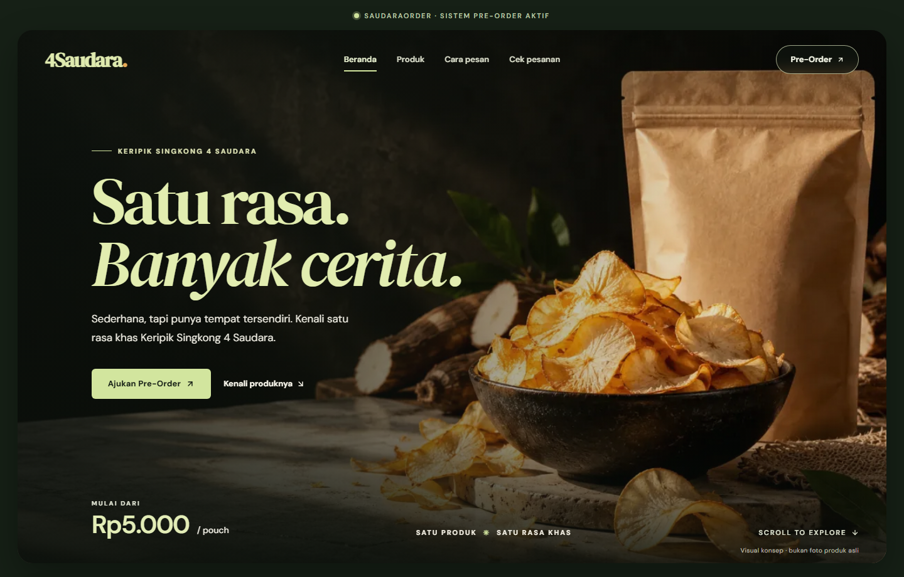
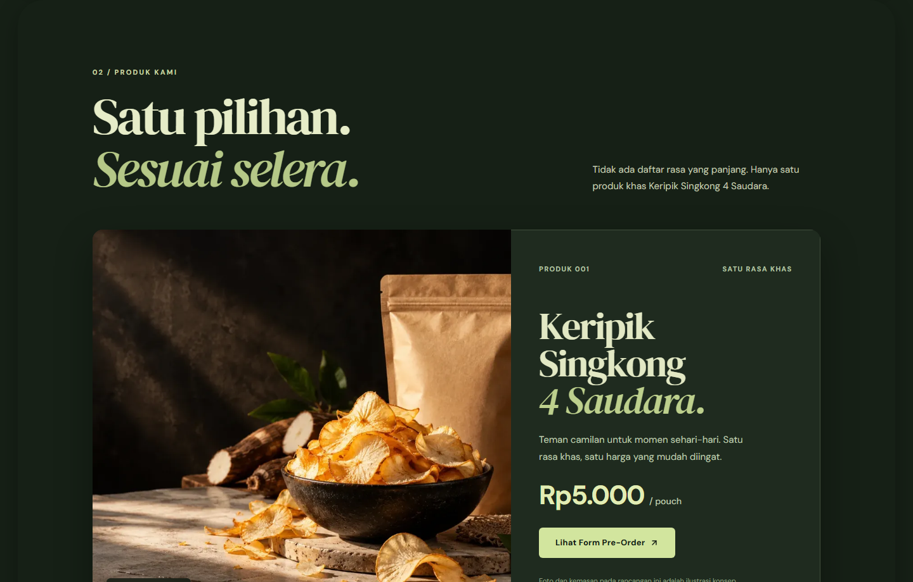
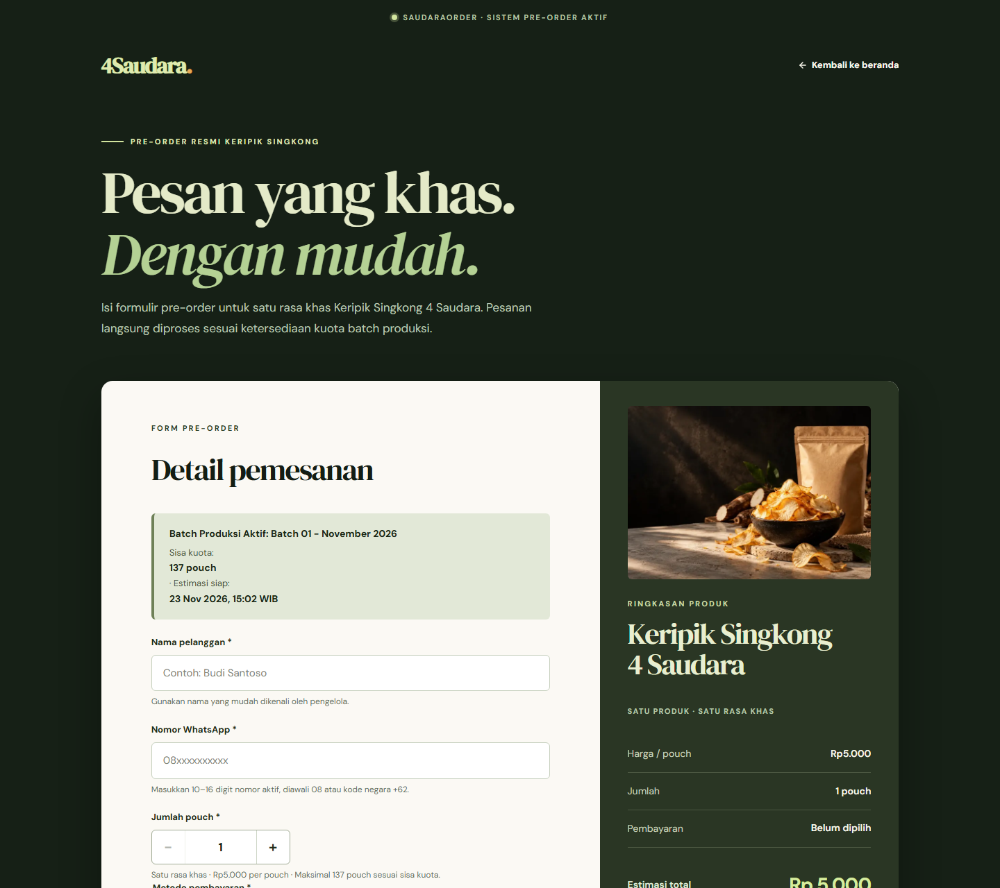
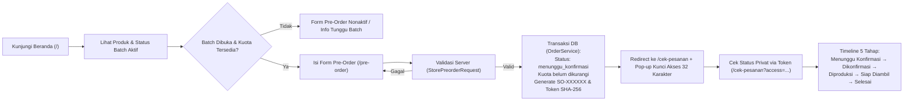
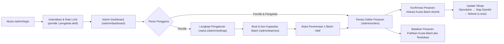
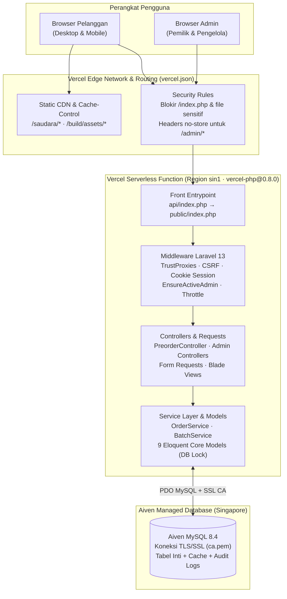

<div align="center">

# SaudaraOrder

**Sistem Informasi Pre-Order, Pengendalian Kuota Batch, dan Pelacakan Pesanan Privat**<br>
*Untuk UMKM Keripik Singkong 4 Saudara — Satu Produk, Satu Rasa Khas, Rp5.000/pouch.*

[](https://saudara-order.vercel.app)
[](https://laravel.com)
[](https://www.php.net)
[](https://aiven.io)
[](https://vite.dev)
[](https://tailwindcss.com)
[-1E5E3A?style=for-the-badge&logo=phpunit&logoColor=white)](phpunit.xml)

[Live Website](https://saudara-order.vercel.app) · [Dokumentasi Teknis](docs/ARCHITECTURE.md) · [PRD](docs/PRD.md) · [Project Memory](docs/project-memory/PROJECT_CONTEXT.md)

</div>

---

## Ringkasan Proyek

**SaudaraOrder** adalah aplikasi web yang dirancang sebagai proyek *Capstone* untuk membantu usaha **Keripik Singkong 4 Saudara** memusatkan pemesanan pre-order, mengendalikan kuota produksi per batch agar tidak terjadi kelebihan alokasi (*overselling*), serta menyediakan pelacakan status pesanan secara privat tanpa mewajibkan pelanggan membuat akun.

Aplikasi ini menggabungkan antarmuka pelanggan dengan pendekatan *Warm Minimalist Editorial* dan ruang kerja pengelola berbasis peran (`pemilik` dan `pengelola`) yang dilindungi autentikasi session Laravel, transaksi database atomik (`lockForUpdate`), serta jejak audit (`audit_logs`).

---

## Tampilan Aplikasi

### Antarmuka Pelanggan

<table>
  <tr>
    <td width="50%" align="center">
      
      <br>
      <sub><b>1. Homepage / Landing Page (<code>/</code>)</b><br>Memperkenalkan identitas merek Keripik Singkong 4 Saudara, harga Rp5.000/pouch, informasi batch aktif, cara pesan, dan FAQ.</sub>
    </td>
    <td width="50%" align="center">
      
      <br>
      <sub><b>2. Pengenalan Produk (<code>/#produk</code>)</b><br>Menonjolkan produk tunggal Satu Rasa Khas dengan harga tetap dan tombol aksi langsung ke formulir pre-order.</sub>
    </td>
  </tr>
  <tr>
    <td width="50%" align="center">
      
      <br>
      <sub><b>3. Formulir Pre-Order (<code>/pre-order</code>)</b><br>Menampilkan status batch aktif, sisa kuota pouch, validasi kontak WhatsApp, pemilih jumlah, dan ringkasan total harga otomatis.</sub>
    </td>
    <td width="50%" align="center">
      
      <br>
      <sub><b>4. Pelacakan Pesanan Privat (<code>/cek-pesanan</code>)</b><br>Halaman pelacakan berbasis kunci akses pribadi 32 karakter (token SHA-256); kode pesanan biasa ditolak demi privasi.</sub>
    </td>
  </tr>
</table>

### Antarmuka Pengelola

<table>
  <tr>
    <td align="center">
      
      <br>
      <sub><b>Admin Login (<code>/admin/login</code>)</b><br>Autentikasi khusus tim internal (<code>pemilik</code> &amp; <code>pengelola</code>) dengan rate limiting dan proteksi CSRF tanpa pendaftaran publik.</sub>
    </td>
  </tr>
</table>

---

## Fitur Aplikasi

Status fitur membedakan kondisi kode di **`main`**, **branch pengembangan** (`feat/redesign-ui`), dan **Production** (`https://saudara-order.vercel.app`):

| Lingkungan | Kondisi Saat Ini |
|---|---|
| **`main`** | Fondasi database 9 entitas, `ProductSeeder`, autentikasi & rate limiting admin, dashboard, manajemen batch/kapasitas, pengaturan usaha, sertifikat CA Aiven. |
| **Branch Pengembangan** | Menambahkan konfigurasi `vercel-php`, backend Pre-Order/Tracking, `Admin\OrderController`, redesign UI/UX Pro Max, dan optimasi performa `sin1`. |
| **Live Production** | Berjalan di `https://saudara-order.vercel.app` menggunakan build penuh dari branch pengembangan + optimasi performa. |

**Klasifikasi:** `Implemented` = end-to-end teruji · `Partial` = sebagian komponen ada · `Planned` = belum diimplementasikan

### Fitur Pelanggan

| Fitur | Endpoint | `main` | Dev & Prod |
|---|---|---|---|
| Informasi Produk & Harga Tunggal | `/` | `Partial` | `Implemented` |
| Formulir Pre-Order Tanpa Akun | `/pre-order` | `Partial` | `Implemented` |
| Idempotency & Penundaan Alokasi Kuota | `OrderService` | `Planned` | `Implemented` |
| Pelacakan Status Pesanan Privat (token SHA-256) | `/cek-pesanan` | `Partial` | `Implemented` |
| Pilihan Pengambilan vs Pengantaran & Alamat | — | `Planned` | `Planned` |

### Fitur Pengelola

| Fitur | Endpoint | `main` | Dev & Prod |
|---|---|---|---|
| Autentikasi & Keamanan Session | `/admin/login` | `Implemented` | `Implemented` |
| Dashboard Ringkasan | `/admin/dashboard` | `Implemented` | `Implemented` |
| Manajemen Batch Produksi & Kapasitas | `/admin/batches*` | `Implemented` | `Implemented` |
| Pengaturan Informasi Usaha | `/admin/settings` | `Implemented` | `Implemented` |
| Manajemen Pesanan & Alokasi Kuota Atomik | `/admin/orders*` | `Planned` | `Implemented` |
| Pencatatan Jejak Audit | `AuditLog` | `Implemented` | `Implemented` |
| Filter/Pencarian UI & Input Pesanan Manual | — | `Planned` | `Partial` |
| Pencatatan Kas, Bukti Bayar & Pembatalan | — | `Partial` | `Partial` |
| Ekspor Laporan Terfilter (F6) | — | `Planned` | `Planned` |

---

## Alur Sistem

### Alur Pelanggan



### Alur Admin



---

## Arsitektur Sistem

SaudaraOrder berjalan menggunakan arsitektur *serverless PHP* di Vercel (`sin1`) yang terhubung melalui TLS ke database terkelola Aiven MySQL di Singapore.



---

## Technology Stack

| Kategori | Teknologi | Versi | Fungsi |
|---|---|---|---|
| **Backend Framework** | Laravel | `^13.0` | Routing, Form Request, Blade, Eloquent ORM, transaksi DB, session auth, CLI `saudara:owner`. |
| **Bahasa Server** | PHP | `^8.3` (Runtime: `8.4.27`) | Logika backend, service transaksi, pengujian. |
| **Templating & UI** | Blade + Tailwind CSS | Tailwind `^4.0.0` | Rendering HTML server-side, halaman publik & admin, desain responsif. |
| **Asset Bundler** | Vite | `^7.0.7` | Kompilasi CSS/JS produksi dan manifest Vite. |
| **Database** | Aiven MySQL | `8.4.11` (TLS `ca.pem`) | Penyimpanan pesanan, batch, kuota, pengguna, cache, dan `audit_logs`. |
| **Testing & Linting** | PHPUnit & Laravel Pint | PHPUnit `^12.5.12` | 64 test otomatis (SQLite `:memory:`) dan standar gaya kode PHP. |
| **Hosting Serverless** | Vercel | `vercel-php@0.8.0` (Region `sin1`) | Endpoint PHP serverless & distribusi aset statis Edge CDN. |
| **Version Control** | Git & GitHub | — | Riwayat kode, branch pengembangan, integrasi deployment. |

---

## Struktur Proyek

```text
saudara-order/
├── api/
│   └── index.php                  # Entrypoint Vercel serverless PHP
├── app/
│   ├── Console/Commands/          # Command CLI interaktif saudara:owner
│   ├── Http/
│   │   ├── Controllers/           # Admin + Preorder Controllers
│   │   ├── Middleware/            # EnsureActiveAdmin, AdminResponseHeaders
│   │   └── Requests/              # Form Request validasi publik & admin
│   ├── Models/                    # 9 model inti (Order, ProductionBatch, Product, AuditLog, dll.)
│   ├── Providers/                 # Gate otorisasi, rate limiter login, view composer
│   └── Services/                  # BatchService & OrderService
├── bootstrap/
│   └── app.php                    # Routing, middleware alias, proxy trust
├── config/                        # Konfigurasi Laravel (database SSL resolver, session)
├── database/
│   ├── certs/                     # Sertifikat CA TLS untuk Aiven MySQL (ca.pem)
│   ├── migrations/                # Skema tabel inti, constraint, cache, sessions
│   └── seeders/                   # ProductSeeder idempotent (Rp5.000/pouch)
├── docs/                          # PRD, arsitektur, desain, progres, screenshots/, project-memory/
├── public/
│   ├── build/                     # Output manifest & aset Vite
│   └── saudara/                   # Stylesheet (site.css, admin.css), JS, gambar WebP
├── resources/
│   ├── css/ & js/                 # Entrypoint Vite & Tailwind CSS v4
│   └── views/                     # Blade layout & halaman pelanggan (pages/) + admin (admin/)
├── routes/
│   ├── web.php                    # Route publik
│   └── admin.php                  # Route terproteksi (/admin/*)
├── tests/
│   └── Feature/                   # AdminWorkspaceTest, DatabaseFoundationTest, PreorderBackendTest
├── composer.json                  # Dependensi PHP
├── package.json                   # Dependensi Vite & Tailwind CSS
└── vercel.json                    # Konfigurasi runtime vercel-php & region sin1
```

---

## Panduan Instalasi Lokal

### Prasyarat

- **PHP** `>= 8.3` dengan ekstensi `pdo_mysql`, `pdo_sqlite`, `openssl`, `mbstring`, `fileinfo`
- **Composer** & **Node.js / NPM**
- **MySQL** `8.x` (lokal atau instance terpisah)

### Langkah Instalasi

1. **Clone repository**
   ```bash
   git clone https://github.com/oelofficial97-coder/saudara-order.git
   cd saudara-order
   ```

2. **Install dependensi**
   ```bash
   composer install --no-interaction
   npm ci
   ```

3. **Salin konfigurasi environment**
   ```bash
   cp .env.example .env
   # Windows PowerShell:
   # Copy-Item .env.example .env
   ```

4. **Generate application key** *(sekali untuk `.env` lokal baru)*
   ```bash
   php artisan key:generate
   ```

5. **Konfigurasi koneksi database di `.env`**
   Sesuaikan `DB_HOST`, `DB_DATABASE`, `DB_USERNAME`, `DB_PASSWORD`. Jika menggunakan MySQL dengan TLS (Aiven), tambahkan `MYSQL_ATTR_SSL_CA` yang menunjuk ke file sertifikat CA yang valid.
   > Jangan pernah menaruh `.env`, password, atau `APP_KEY` ke Git.

6. **Jalankan migrasi & seeder**
   ```bash
   php artisan migrate
   php artisan db:seed --class=ProductSeeder
   ```

7. **(Opsional) Buat akun pemilik pertama**
   ```bash
   php artisan saudara:owner
   ```

8. **Build aset & jalankan server**
   ```bash
   npm run build
   php artisan serve
   ```
   Akses di `http://127.0.0.1:8000` — admin di `/admin/login`.

---

## Pengujian & Kualitas Kode

Pengujian menggunakan database SQLite `:memory:` agar tidak menyentuh database pengembangan atau produksi:

| Tujuan | Perintah | Hasil |
|---|---|---|
| Jalankan seluruh test | `php artisan test` | `64 passed (507 assertions)` |
| Periksa format kode | `php vendor/bin/pint --test` | `passed` |
| Build aset produksi | `npm run build` | Bundle CSS/JS ke `public/build/` |

---

## Project Roadmap

| Status | Fitur / Milestone | Kondisi Saat Ini |
|---|---|---|
| ✅ `Completed (main)` | **Fondasi Database & Model Inti** | 9 tabel inti, foreign key, indeks, `ProductSeeder`, dan `audit_logs` tersedia di `main`. |
| ✅ `Completed (main)` | **Workspace Admin, Batch & Pengaturan** | Login terproteksi, dashboard, manajemen batch/kapasitas, pengaturan usaha tersedia di `main`. |
| ✅ `Completed (Dev & Prod)` | **Antarmuka Pelanggan & Redesign UI/UX** | Landing page, `/pre-order`, `/pesanan-berhasil`, `/cek-pesanan` responsif aktif di Production. |
| ✅ `Completed (Dev & Prod)` | **Backend Pre-Order & Tracking Privat** | `OrderService`, idempotency key, snapshot harga, token SHA-256, `Admin\OrderController` aktif. |
| ✅ `Completed (Dev & Prod)` | **Deployment Vercel & Optimasi Performa** | `https://saudara-order.vercel.app` (`sin1`), Aiven MySQL TLS, cookie session terenkripsi. |
| 🔄 `In Progress` | **Pencarian UI & Input Pesanan Manual Admin** | Query parameter sudah ada; form pencarian/filter UI dan input manual perlu dilengkapi. |
| 🔄 `In Progress` | **Screenshot Admin & Finalisasi Dokumentasi** | Screenshot halaman admin terautentikasi belum diambil. |
| 📋 `Planned` | **Pencatatan Kas Tunai & Penyerahan Terpisah (F5)** | Skema `cash_transactions` sudah ada; controller & UI belum diaktifkan. |
| 📋 `Planned` | **Opsi Pengantaran & Alamat Kondisional (F1/F3)** | Pilihan ambil/antar & validasi alamat sesuai spesifikasi PRD/SPEC. |
| 📋 `Planned` | **Rekap & Ekspor Laporan Operasional (F6)** | Laporan transaksi terfilter dan fitur ekspor untuk pemilik usaha. |

---

## Project Memory & Development History

Direktori `docs/project-memory/` menyimpan seluruh perjalanan pengembangan **SaudaraOrder** — mulai dari konteks bisnis, kronologi implementasi, keputusan teknis, status produksi terkini, hingga catatan lintas sesi — sebagai sumber konteks terpusat bagi developer maupun asisten AI yang melanjutkan proyek.

1. **[Project Context](docs/project-memory/PROJECT_CONTEXT.md)** — Identitas usaha Keripik Singkong 4 Saudara, latar belakang masalah, tujuan sistem, aturan bisnis inti, stack teknologi, serta peta status fitur.
2. **[Work History](docs/project-memory/WORK_HISTORY.md)** — Kronologi lengkap 12 fase perjalanan pengembangan dari inisialisasi Laravel 13 hingga optimasi produksi, lengkap dengan tanggal dan hash commit terverifikasi.
3. **[Technical Decisions](docs/project-memory/DECISIONS.md)** — Catatan keputusan arsitektur dan teknis (Laravel 13, Aiven MySQL TLS, Vercel `sin1`, Blade/Vite, cookie session terenkripsi, routing HTTPS) beserta alasan dan konsekuensinya.
4. **[Current State](docs/project-memory/CURRENT_STATE.md)** — Potret kondisi aktual repository, perubahan working tree, status deployment Production Vercel, kondisi database Aiven, dan hasil pengujian terbaru.
5. **[Project Handoff](docs/project-memory/HANDOFF.md)** — Panduan serah terima: daftar tugas selesai vs belum selesai, prioritas berikutnya, checklist awal sesi baru, dan acceptance criteria.
6. **[Session Log](docs/project-memory/SESSION_LOG.md)** — Catatan kronologis aktivitas per sesi pengembangan (analisis, perubahan berkas, pengujian, kendala, dan solusi).
7. **[AI Work Rules](docs/project-memory/AI_WORK_RULES.md)** — Aturan kerja wajib, batasan keamanan Git/database/kredensial, standar deployment, serta peta sumber kebenaran dokumen proyek.

---

## Dokumentasi Pendukung

- [SPEC.json](SPEC.json) — Spesifikasi keputusan produk, fitur `F1–F6`, dan acceptance criteria.
- [docs/PRD.md](docs/PRD.md) — Product Requirements Document SaudaraOrder.
- [docs/ARCHITECTURE.md](docs/ARCHITECTURE.md) — Arsitektur komponen, alur data, dan batasan lingkungan.
- [docs/SECURITY.md](docs/SECURITY.md) — Kebijakan privasi, autentikasi, dan mitigasi risiko keamanan.
- [docs/TESTING.md](docs/TESTING.md) — Strategi pengujian terisolasi dan daftar skenario uji.
- [docs/PROGRESS.md](docs/PROGRESS.md) & [docs/TASKS.md](docs/TASKS.md) — Catatan progres dan daftar tugas proyek.
- [docs/screenshots/README.md](docs/screenshots/README.md) — Panduan pengambilan dan pemasangan screenshot admin.
