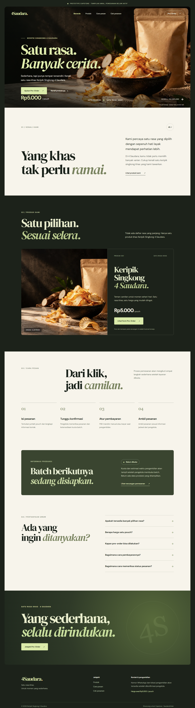

# SaudaraOrder

### Sistem Pre-Order Keripik Singkong 4 Saudara Berbasis Web

**Capstone Project — Teknik Informatika**



## Tentang Project

SaudaraOrder merupakan aplikasi berbasis web yang dikembangkan untuk membantu usaha Keripik Singkong 4 Saudara dalam pengelolaan pre-order, pesanan pelanggan, batch produksi, pembayaran, dan laporan penjualan.

Produk utama adalah keripik singkong dengan satu rasa khas dan harga Rp5.000 per pouch.

## Teknologi

- Laravel 13
- PHP
- MySQL (tahap pengembangan berikutnya)
- Blade Template
- CSS dan JavaScript
- Git dan GitHub
- Google Antigravity IDE

## Progress Pengembangan

**Minggu 3 — Prototipe Frontend**

- [x] Repository GitHub
- [x] Instalasi Laravel
- [x] Penyusunan PRD
- [x] Desain landing page
- [x] Tampilan halaman pre-order
- [x] Tampilan cek pesanan
- [ ] Integrasi database MySQL
- [ ] Sistem pemesanan aktif
- [ ] Dashboard admin
- [ ] Manajemen batch dan kuota
- [ ] Pembayaran dan laporan
- [ ] Pengujian sistem lengkap

## Dokumentasi

- [Product Requirements Document](docs/PRD.md)
- [Laporan Minggu 3](docs/progress/minggu-03.md)

## Menjalankan Project Secara Lokal

```bash
composer install
npm install
```

Salin `.env.example` menjadi `.env`, lalu jalankan:

```bash
php artisan key:generate
npm run build
php artisan serve
```

Buka `http://127.0.0.1:8000`.

## Catatan Pengembangan

Website saat ini berada pada tahap prototipe frontend. Penyimpanan pesanan, pengelolaan kuota, dan transaksi pembayaran belum diaktifkan.

## Lisensi dan Penggunaan

Project dikembangkan untuk kebutuhan Capstone akademik. Penggunaan aset visual produk akan disesuaikan dengan dokumentasi usaha yang sebenarnya.
