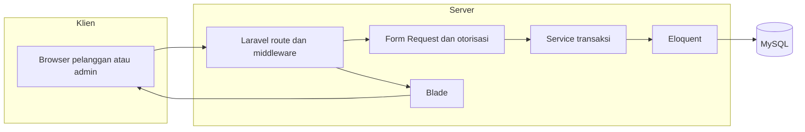

# Architecture: SaudaraOrder

## Overview

SaudaraOrder adalah aplikasi web existing dengan Laravel dan PHP di server, Blade sebagai template, serta CSS/JavaScript dan Vite untuk frontend. MySQL menyimpan sembilan entitas inti dan tabel pendukung Laravel. Browser tidak menentukan harga, kuota, atau izin. PHPUnit memeriksa perilaku aplikasi, sedangkan bukti konkurensi harus berasal dari MySQL testing.

## Tech Stack

| Lapisan | Pilihan | Alasan | Alternatif yang ditolak |
|---|---|---|---|
| frontend | Blade, CSS dan JavaScript existing, Vite; Tailwind tersedia sebagai dependensi. | Mempertahankan fondasi existing (pilihan mahasiswa) | - |
| backend | PHP dan Laravel existing. | Mempertahankan fondasi existing (pilihan mahasiswa) | - |
| database | MySQL, database pengembangan preorder_4_saudara; tidak diganti. | Mempertahankan fondasi existing (pilihan mahasiswa) | - |
| auth | Session Laravel, password hash, rate limiting, role pemilik/pengelola dan akun aktif. | Mempertahankan fondasi existing (pilihan mahasiswa) | - |
| hosting | Evaluasi Vercel terlebih dahulu; kandidat database Aiven MySQL Free; Render Docker hanya alternatif setelah persetujuan, bukan pengganti otomatis kewajiban UTS Vercel. | Mempertahankan fondasi existing (pilihan mahasiswa) | - |
| testing | PHPUnit, evaluasi browser automation seperti Playwright, UAT, pengujian MySQL dan konkurensi terpisah. | Mempertahankan fondasi existing (pilihan mahasiswa) | - |

SaudaraOrder merupakan proyek existing yang telah memiliki implementasi frontend, backend, autentikasi, database, dan pengujian. Mempertahankan stack menghindari pembangunan ulang, migrasi yang tidak diperlukan, dan risiko kerusakan fitur yang sudah berjalan.

- composer.json: PHP ^8.3; Laravel ^13.0; PHPUnit ^12.5.12; Pint ^1.27.
- package.json: Vite ^7.0.7; Tailwind CSS ^4.0.0.
- MySQL 8.4.3 menurut kondisi proyek yang dikonfirmasi; verifikasi runtime sebelum deployment.

Pendukung: Composer, NPM, Tailwind CSS, Laravel Pint. Versi deklarasi dependency bukan klaim versi runtime hosting.

## System Diagram



Batas kepercayaan berada antara browser dan server; payload tidak boleh mengubah status atau nominal secara bebas.

## Project Structure

```text
app/                 controller, request, model, service, command
bootstrap/           konfigurasi aplikasi
config/              konfigurasi Laravel
routes/              web dan admin existing
resources/views/     Blade publik dan admin
public/saudara/       aset desain existing
database/            migration, seeder, factory
tests/               PHPUnit terisolasi
docs/                dokumen engineering dan progres lama
.github/             konfigurasi existing; perubahan perlu review
AGENTS.md            panduan agen
README.md            existing; draf pengganti menunggu izin
SPEC.json            keputusan yang disetujui
```

## Data Model

### users

| Field/kelompok | Tipe konseptual | Keterangan |
|---|---|---|
| id | integer/FK | Ringkasan kebutuhan, bukan definisi SQL baru |
| name | ikuti migration existing | Ringkasan kebutuhan, bukan definisi SQL baru |
| username | ikuti migration existing | Ringkasan kebutuhan, bukan definisi SQL baru |
| password | ikuti migration existing | Ringkasan kebutuhan, bukan definisi SQL baru |
| role | ikuti migration existing | Ringkasan kebutuhan, bukan definisi SQL baru |
| is_active | ikuti migration existing | Ringkasan kebutuhan, bukan definisi SQL baru |

### products

| Field/kelompok | Tipe konseptual | Keterangan |
|---|---|---|
| id | integer/FK | Ringkasan kebutuhan, bukan definisi SQL baru |
| name | ikuti migration existing | Ringkasan kebutuhan, bukan definisi SQL baru |
| price_rupiah | integer | Ringkasan kebutuhan, bukan definisi SQL baru |
| satuan pouch | ikuti migration existing | Ringkasan kebutuhan, bukan definisi SQL baru |
| satu rasa khas | ikuti migration existing | Ringkasan kebutuhan, bukan definisi SQL baru |

### business_settings

| Field/kelompok | Tipe konseptual | Keterangan |
|---|---|---|
| id | integer/FK | Ringkasan kebutuhan, bukan definisi SQL baru |
| kontak | ikuti migration existing | Ringkasan kebutuhan, bukan definisi SQL baru |
| alamat usaha | ikuti migration existing | Data pribadi; akses terbatas |
| rekening opsional | ikuti migration existing | Ringkasan kebutuhan, bukan definisi SQL baru |
| active_batch_id | integer/FK | Ringkasan kebutuhan, bukan definisi SQL baru |

### production_batches

| Field/kelompok | Tipe konseptual | Keterangan |
|---|---|---|
| id | integer/FK | Ringkasan kebutuhan, bukan definisi SQL baru |
| product_id | integer/FK | Ringkasan kebutuhan, bukan definisi SQL baru |
| capacity_pouches | integer | Ringkasan kebutuhan, bukan definisi SQL baru |
| allocated_pouches | integer | Ringkasan kebutuhan, bukan definisi SQL baru |
| status penerimaan | ikuti migration existing | Ringkasan kebutuhan, bukan definisi SQL baru |
| estimasi siap | ikuti migration existing | Ringkasan kebutuhan, bukan definisi SQL baru |
| started_at | timestamp | Ringkasan kebutuhan, bukan definisi SQL baru |
| completed_at | timestamp | Ringkasan kebutuhan, bukan definisi SQL baru |

### orders

| Field/kelompok | Tipe konseptual | Keterangan |
|---|---|---|
| id | integer/FK | Ringkasan kebutuhan, bukan definisi SQL baru |
| batch_id | integer/FK | Ringkasan kebutuhan, bukan definisi SQL baru |
| kode unik | ikuti migration existing | Ringkasan kebutuhan, bukan definisi SQL baru |
| idempotency_key | ikuti migration existing | Ringkasan kebutuhan, bukan definisi SQL baru |
| nama pelanggan | ikuti migration existing | Data pribadi; akses terbatas |
| WhatsApp | ikuti migration existing | Data pribadi; akses terbatas |
| sumber | ikuti migration existing | Ringkasan kebutuhan, bukan definisi SQL baru |
| quantity_pouches | integer | Ringkasan kebutuhan, bukan definisi SQL baru |
| unit_price_rupiah | integer | Ringkasan kebutuhan, bukan definisi SQL baru |
| total_rupiah | integer | Ringkasan kebutuhan, bukan definisi SQL baru |
| status pesanan | ikuti migration existing | Ringkasan kebutuhan, bukan definisi SQL baru |
| status pembayaran | ikuti migration existing | Ringkasan kebutuhan, bukan definisi SQL baru |
| hash token | ikuti migration existing | Ringkasan kebutuhan, bukan definisi SQL baru |
| metode penyerahan (kebutuhan) | ikuti migration existing | Ringkasan kebutuhan, bukan definisi SQL baru |
| alamat pengantaran (kebutuhan) | ikuti migration existing | Data pribadi; akses terbatas |
| kondisi penyerahan (kebutuhan) | ikuti migration existing | Ringkasan kebutuhan, bukan definisi SQL baru |

### payment_proofs

| Field/kelompok | Tipe konseptual | Keterangan |
|---|---|---|
| id | integer/FK | Ringkasan kebutuhan, bukan definisi SQL baru |
| order_id | integer/FK | Ringkasan kebutuhan, bukan definisi SQL baru |
| berkas privat | ikuti migration existing | Ringkasan kebutuhan, bukan definisi SQL baru |
| status verifikasi; fitur belum diaktifkan | ikuti migration existing | Ringkasan kebutuhan, bukan definisi SQL baru |

### cash_transactions

| Field/kelompok | Tipe konseptual | Keterangan |
|---|---|---|
| id | integer/FK | Ringkasan kebutuhan, bukan definisi SQL baru |
| order_id | integer/FK | Ringkasan kebutuhan, bukan definisi SQL baru |
| jenis transaksi | ikuti migration existing | Ringkasan kebutuhan, bukan definisi SQL baru |
| nominal integer rupiah | integer | Ringkasan kebutuhan, bukan definisi SQL baru |
| action_key | ikuti migration existing | Ringkasan kebutuhan, bukan definisi SQL baru |
| waktu | timestamp | Ringkasan kebutuhan, bukan definisi SQL baru |
| admin | ikuti migration existing | Ringkasan kebutuhan, bukan definisi SQL baru |

### cancellation_requests

| Field/kelompok | Tipe konseptual | Keterangan |
|---|---|---|
| id | integer/FK | Ringkasan kebutuhan, bukan definisi SQL baru |
| order_id | integer/FK | Ringkasan kebutuhan, bukan definisi SQL baru |
| alasan | ikuti migration existing | Ringkasan kebutuhan, bukan definisi SQL baru |
| status permintaan | ikuti migration existing | Ringkasan kebutuhan, bukan definisi SQL baru |
| keputusan | ikuti migration existing | Ringkasan kebutuhan, bukan definisi SQL baru |

### audit_logs

| Field/kelompok | Tipe konseptual | Keterangan |
|---|---|---|
| id | integer/FK | Ringkasan kebutuhan, bukan definisi SQL baru |
| pelaku | ikuti migration existing | Ringkasan kebutuhan, bukan definisi SQL baru |
| order/batch terkait | ikuti migration existing | Ringkasan kebutuhan, bukan definisi SQL baru |
| tindakan | ikuti migration existing | Ringkasan kebutuhan, bukan definisi SQL baru |
| sebelum/sesudah | ikuti migration existing | Ringkasan kebutuhan, bukan definisi SQL baru |
| waktu | timestamp | Ringkasan kebutuhan, bukan definisi SQL baru |

products memiliki banyak production_batches; orders milik production_batches. orders memiliki payment_proofs, cash_transactions dan cancellation_requests. audit_logs dapat merujuk users, orders dan production_batches. business_settings menunjuk satu active_batch_id. Semua FK, enum dan indeks diperiksa dari migration sebelum perubahan. Kolom penyerahan/alamat belum boleh dianggap tersedia. customer_phone existing non-null dan order_source menggunakan titipan; pemetaan kebutuhan terbaru memerlukan audit. Migration rekening nullable telah ada sebagai pekerjaan sebelumnya tetapi penerapannya pada database belum diverifikasi sesi ini.

## Data Flow

1. F1: Form Request memvalidasi identitas, integer jumlah dan alamat bersyarat. Service memilih batch terbuka, menghitung snapshot, memeriksa idempotensi, menyimpan pesanan dan hash token tanpa alokasi, baru merespons berhasil.
2. F2/F3: middleware memeriksa staf aktif dan role; transaksi mengunci pengaturan batch aktif, batch, lalu pesanan dalam urutan konsisten. Periksa kesepakatan pengantaran dan kapasitas; ubah alokasi, status serta audit atomik.
3. F5: validasi nominal dan action key; transaksi mencatat kas dan status pembayaran tanpa menimpa riwayat. Penyelesaian memeriksa penyerahan dan lunas. F4 selalu memverifikasi kode/token sebelum membaca detail.

## External Services

Tidak ada integrasi layanan operasional tambahan. Vercel dan Aiven merupakan kandidat hosting/database untuk dievaluasi, bukan layanan yang telah dipasang.

| Layanan | Fungsi | Data | Batas/biaya | Cadangan |
|---|---|---|---|---|
| Vercel | Demo web UTS | Kode dan konfigurasi deployment setelah izin | Cek paket terbaru dan runtime PHP komunitas | Laporkan kendala; Render bukan pengganti otomatis kewajiban dosen |
| Aiven MySQL | Kandidat database | Data aplikasi setelah rencana migrasi disetujui | Cek paket terbaru | Rencana pemulihan perlu evaluasi |
| Render Docker | Alternatif | Image aplikasi setelah izin | Cek paket terbaru | Keputusan mahasiswa |

## Environments and Configuration

Lokal mempertahankan .env dan database pengembangan. Testing memakai SQLite in-memory atau database MySQL khusus yang terisolasi. Preview/produksi mempunyai environment variables sendiri dan tidak memakai kredensial lokal.

Nama variabel: APP_ENV, APP_DEBUG, APP_URL, APP_KEY, DB_CONNECTION, DB_HOST, DB_PORT, DB_DATABASE, DB_USERNAME, DB_PASSWORD, SESSION_DRIVER, CACHE_STORE, QUEUE_CONNECTION. APP_KEY dan kredensial database rahasia. Persyaratan TLS database diverifikasi terhadap layanan terpilih. Jangan mencetak konfigurasi efektif yang mengandung rahasia.

## Deployment

P0 UTS 10 November 2026: evaluasi Vercel/PHP terlebih dahulu, termasuk runtime yang dipelihara, session database, routing, aset Vite, koneksi MySQL dan filesystem. Setelah mahasiswa menyetujui rencana serta perubahan konkret, baru integrasikan GitHub dan jalankan deployment. Perintah build kanonis: `npm run build`. Desain CI GitHub Actions dan merge ke main belum merupakan izin untuk menjalankannya. Periksa HTTPS, halaman publik, login/logout dan fitur yang diklaim siap. Rollback kode ke deployment terakhir yang teruji; pemulihan data tidak otomatis dilakukan. Jangan menyatakan demo berhasil hanya karena build hijau.

## Platform Notes

- Server-rendered Blade; tidak ada aplikasi native atau SPA baru.
- Tidak ada PWA, offline, realtime atau multi-bahasa.
- SEO baru bukan ruang lingkup; seo=false tidak menghapus metadata existing.
- Halaman tracking privat tidak boleh diindeks atau masuk cache bersama.
- Keputusan kuota selalu memakai data server terbaru.
- Antarmuka mobile mempertahankan desain existing.

## Constraints and Trade-offs

Satu mahasiswa dan sepuluh minggu membatasi cakupan; Must didahulukan terhadap Should, dengan P0 UTS terpisah. ADR-001 membahas platform; ADR-002 menjaga frontend; ADR-003 mempertahankan MySQL; ADR-004 mengatur akses; ADR-005 mencatat hosting bersyarat; ADR-006 memisahkan pengujian SQLite dan MySQL. Tidak ada klaim mengenai kemampuan mahasiswa di luar refleksi yang diberikan.
