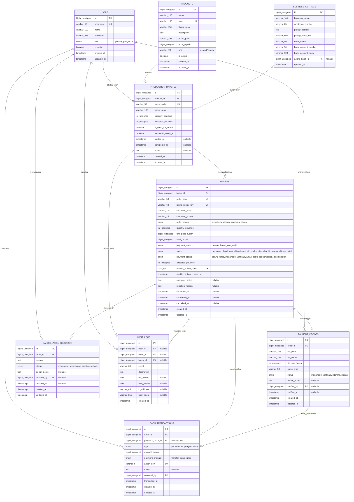

# Perancangan Database dan Entity Relationship Diagram (ERD)
**SaudaraOrder — Sistem Pre-Order Keripik Singkong 4 Saudara Berbasis Web**  
*Capstone Project — Teknik Informatika*  
*Versi Dokumen: 1.0 | Tanggal: 26 Oktober 2026*  
*Basis Spesifikasi: [PRD Versi 2.0](PRD.md)*

---

## 1. Pendahuluan dan Prinsip Perancangan

Perancangan basis data untuk sistem **SaudaraOrder** dirancang untuk mendukung operasional pre-order keripik singkong dengan karakteristik:
1. **Satu Produk, Satu Rasa Khas**: Model data terfokus pada efisiensi transaksi satu produk utama (*single product SKU*) dengan satuan *pouch*.
2. **Pengendalian Kuota Batch yang Ketat (*Concurrency Safe*)**: Menjamin alokasi pesanan tidak melebihi kapasitas batch produksi melalui mekanisme penguncian baris (*pessimistic row locking* - `SELECT ... FOR UPDATE`) dan integritas transaksional ACID.
3. **Pemisahan Audit dan Finansial**: Memisahkan bukti transfer (*payment proof*) dari pencatatan mutasi kas riil (*cash transaction*) guna mencegah pencatatan ganda (*double booking*) dan mempermudah rekonsiliasi kas.
4. **Keamanan Tanpa Akun Konsumen (*Zero-Knowledge Customer Auth*)**: Konsumen melacak pesanan menggunakan *cryptographically secure tracking token* (32-byte random) yang disimpan dalam bentuk *hash SHA-256*, mencegah enumerasi kode pesanan oleh pihak luar.
5. **Standar RDBMS**: Menggunakan MySQL 8.4 LTS dengan engine **InnoDB**, karakter set `utf8mb4`, dan *collation* `utf8mb4_unicode_ci`.

---

## 2. Entity Relationship Diagram (ERD)

Diagram di bawah ini menggambarkan seluruh entitas inti sistem, atribut utama (*Primary Key*, *Foreign Key*), serta kardinalitas relasi antar entitas menggunakan notasi *Crow's Foot*.



---

## 3. Kamus Data Fisik (Data Dictionary)

### 3.1 Tabel `users`
Menyimpan akun administrator internal (pemilik usaha dan pengelola). Konsumen tidak memiliki akun pada sistem.

| Nama Kolom | Tipe Data & Panjang | Nullable | Keterangan & Constraint |
|---|---|---|---|
| `id` | BIGINT UNSIGNED | NO | Primary Key, Auto Increment |
| `name` | VARCHAR(100) | NO | Nama lengkap pengguna admin |
| `username` | VARCHAR(50) | NO | Unique Identifier untuk login |
| `password` | VARCHAR(255) | NO | Bcrypt / Argon2ID password hash |
| `role` | ENUM('pemilik', 'pengelola') | NO | Role hak akses (RBAC) |
| `is_active` | BOOLEAN | NO | Default `true`. Akun dinonaktifkan tidak dapat login |
| `remember_token` | VARCHAR(100) | YES | Token persistensi sesi Laravel |
| `created_at` | TIMESTAMP | YES | Waktu pendaftaran akun |
| `updated_at` | TIMESTAMP | YES | Waktu perubahan terakhir data akun |

*Indeks:*
- `PRIMARY` (`id`)
- `users_username_unique` (`username`)

---

### 3.2 Tabel `products`
Menyimpan profil produk keripik singkong. Pada rilis awal, terdapat 1 produk aktif dengan harga standar Rp5.000 per pouch.

| Nama Kolom | Tipe Data & Panjang | Nullable | Keterangan & Constraint |
|---|---|---|---|
| `id` | BIGINT UNSIGNED | NO | Primary Key, Auto Increment |
| `name` | VARCHAR(100) | NO | Nama produk (contoh: "Keripik Singkong 4 Saudara") |
| `slug` | VARCHAR(100) | NO | URL slug unik (contoh: "keripik-singkong-4-saudara") |
| `flavor_name` | VARCHAR(255) | NO | Keterangan rasa ("Satu Rasa Khas") |
| `description` | TEXT | NO | Deskripsi detail bahan dan keunggulan produk |
| `photo_path` | VARCHAR(255) | YES | Path penyimpanan foto produk di storage publik |
| `price_rupiah` | BIGINT UNSIGNED | NO | Harga satuan saat ini (Rp5.000) |
| `unit` | VARCHAR(20) | NO | Default `'pouch'` |
| `is_active` | BOOLEAN | NO | Default `true` |
| `created_at` | TIMESTAMP | YES | Waktu pencatatan produk |
| `updated_at` | TIMESTAMP | YES | Waktu perubahan spesifikasi/harga produk |

*Indeks:*
- `PRIMARY` (`id`)
- `products_slug_unique` (`slug`)

---

### 3.3 Tabel `business_settings`
Menyimpan konfigurasi profil usaha 4 Saudara, kontak operasional, nomor rekening bank, dan pointer batch pre-order aktif.

| Nama Kolom | Tipe Data & Panjang | Nullable | Keterangan & Constraint |
|---|---|---|---|
| `id` | BIGINT UNSIGNED | NO | Primary Key, Auto Increment (baris tunggal / singleton ID = 1) |
| `business_name` | VARCHAR(100) | NO | Default `'Keripik Singkong 4 Saudara'` |
| `whatsapp_number` | VARCHAR(25) | NO | Nomor WhatsApp resmi usaha (contoh: `6281234567890`) |
| `pickup_address` | TEXT | NO | Alamat lengkap lokasi pengambilan pesanan |
| `pickup_maps_url` | VARCHAR(500) | YES | Tautan Google Maps titik penyerahan barang |
| `bank_name` | VARCHAR(50) | NO | Nama bank tujuan transfer (contoh: "BCA", "BRI", "Mandiri") |
| `bank_account_number`| VARCHAR(50) | NO | Nomor rekening resmi usaha |
| `bank_account_name` | VARCHAR(100) | NO | Nama pemilik rekening resmi |
| `active_batch_id` | BIGINT UNSIGNED | YES | Foreign Key ke `production_batches.id`. Batch yang saat ini menerima pesanan |
| `created_at` | TIMESTAMP | YES | Waktu pembuatan pengaturan |
| `updated_at` | TIMESTAMP | YES | Waktu perubahan konfigurasi |

*Foreign Key & Constraint:*
- `fk_settings_active_batch`: `FOREIGN KEY (active_batch_id) REFERENCES production_batches(id) ON DELETE SET NULL`

---

### 3.4 Tabel `production_batches`
Menyimpan data kelompok/periode produksi pre-order, kuota kapasitas, alokasi yang telah terikat, dan status operasional.

| Nama Kolom | Tipe Data & Panjang | Nullable | Keterangan & Constraint |
|---|---|---|---|
| `id` | BIGINT UNSIGNED | NO | Primary Key, Auto Increment |
| `product_id` | BIGINT UNSIGNED | NO | Foreign Key ke `products.id` |
| `batch_code` | VARCHAR(50) | NO | Kode unik batch (contoh: `BATCH-202610-01`) |
| `batch_name` | VARCHAR(100) | NO | Nama batch (contoh: "Batch Pre-Order Minggu IV Oktober") |
| `capacity_pouches` | INT UNSIGNED | NO | Kapasitas kuota maksimal batch (satuan pouch) |
| `allocated_pouches` | INT UNSIGNED | NO | Default `0`. Kuota yang telah teralokasi pada pesanan aktif |
| `is_open_for_orders`| BOOLEAN | NO | Default `true`. `true` = formulir terbuka menerima pesanan baru |
| `estimated_ready_at`| DATETIME | YES | Estimasi tanggal & waktu barang siap diambil |
| `started_at` | TIMESTAMP | YES | Waktu batch mulai diproduksi (kapasitas dikunci) |
| `completed_at` | TIMESTAMP | YES | Waktu batch dinyatakan tuntas |
| `notes` | TEXT | YES | Catatan internal pengelola mengenai batch |
| `created_at` | TIMESTAMP | YES | Waktu pembuatan batch |
| `updated_at` | TIMESTAMP | YES | Waktu pembaruan status batch |

*Foreign Key, Constraint & Indeks:*
- `PRIMARY` (`id`)
- `production_batches_batch_code_unique` (`batch_code`)
- `fk_batches_product`: `FOREIGN KEY (product_id) REFERENCES products(id) ON DELETE RESTRICT`
- `chk_batches_capacity`: `CHECK (capacity_pouches > 0)`
- `chk_batches_allocation`: `CHECK (allocated_pouches >= 0 AND allocated_pouches <= capacity_pouches)`
- Index `idx_batches_status` (`is_open_for_orders`, `completed_at`)

---

### 3.5 Tabel `orders`
Menyimpan seluruh data transaksi pre-order dari berbagai kanal (website, WhatsApp, langsung, dan titipan).

| Nama Kolom | Tipe Data & Panjang | Nullable | Keterangan & Constraint |
|---|---|---|---|
| `id` | BIGINT UNSIGNED | NO | Primary Key, Auto Increment |
| `batch_id` | BIGINT UNSIGNED | NO | Foreign Key ke `production_batches.id` |
| `order_code` | VARCHAR(50) | NO | Nomor unik pesanan yang ramah baca (contoh: `SO-202610-0042`) |
| `idempotency_key` | VARCHAR(64) | NO | Kunci idempotensi unik dari klien untuk mencegah double submission |
| `customer_name` | VARCHAR(100) | NO | Nama pemesan |
| `customer_phone` | VARCHAR(25) | NO | Nomor telepon / WhatsApp pemesan |
| `order_source` | ENUM(...) | NO | Kanal pesanan: `'website'`, `'whatsapp'`, `'langsung'`, `'titipan'` |
| `quantity_pouches`| INT UNSIGNED | NO | Jumlah pouch yang dipesan (harus > 0) |
| `unit_price_rupiah`| BIGINT UNSIGNED | NO | Snapshot harga satuan saat pesanan dibuat (Rp5.000) |
| `total_rupiah` | BIGINT UNSIGNED | NO | Total nilai pesanan (`quantity_pouches` × `unit_price_rupiah`) |
| `payment_method` | ENUM(...) | NO | Cara bayar: `'transfer'`, `'bayar_saat_ambil'` |
| `status` | ENUM(...) | NO | Alur status: `'menunggu_konfirmasi'`, `'dikonfirmasi'`, `'diproduksi'`, `'siap_diambil'`, `'selesai'`, `'ditolak'`, `'batal'` |
| `payment_status` | ENUM(...) | NO | Status keuangan: `'belum_lunas'`, `'menunggu_verifikasi'`, `'lunas'`, `'perlu_pengembalian'`, `'dikembalikan'` |
| `allocated_pouches`| INT UNSIGNED | NO | Kuota terikat: bernilai = `quantity_pouches` jika status in ('dikonfirmasi','diproduksi','siap_diambil','selesai'), bernilai `0` jika status lainnya |
| `tracking_token_hash`| CHAR(64) | NO | Hash SHA-256 dari token pelacakan privat (32-byte secure random) |
| `tracking_token_created_at`| TIMESTAMP | NO | Waktu token diterbitkan (mendukung regenerasi token jika hilang) |
| `customer_notes` | TEXT | YES | Catatan khusus dari pelanggan |
| `rejection_reason`| TEXT | YES | Alasan jika pesanan ditolak pengelola |
| `confirmed_at` | TIMESTAMP | YES | Waktu pesanan dikonfirmasi oleh pengelola |
| `completed_at` | TIMESTAMP | YES | Waktu pesanan diambil dan diselesaikan |
| `cancelled_at` | TIMESTAMP | YES | Waktu pesanan dibatalkan |
| `created_at` | TIMESTAMP | YES | Waktu pengajuan pesanan |
| `updated_at` | TIMESTAMP | YES | Waktu perubahan terakhir |

*Foreign Key, Constraint & Indeks:*
- `PRIMARY` (`id`)
- `orders_order_code_unique` (`order_code`)
- `orders_idempotency_key_unique` (`idempotency_key`)
- `orders_tracking_token_hash_unique` (`tracking_token_hash`)
- `fk_orders_batch`: `FOREIGN KEY (batch_id) REFERENCES production_batches(id) ON DELETE RESTRICT`
- `chk_orders_quantity`: `CHECK (quantity_pouches > 0)`
- `chk_orders_total`: `CHECK (total_rupiah = quantity_pouches * unit_price_rupiah)`
- Index `idx_orders_batch_status` (`batch_id`, `status`)
- Index `idx_orders_created_at` (`created_at`)
- Index `idx_orders_customer_phone` (`customer_phone`)

---

### 3.6 Tabel `payment_proofs`
Menyimpan berkas bukti transfer yang diunggah oleh konsumen setelah pesanan dikonfirmasi.

| Nama Kolom | Tipe Data & Panjang | Nullable | Keterangan & Constraint |
|---|---|---|---|
| `id` | BIGINT UNSIGNED | NO | Primary Key, Auto Increment |
| `order_id` | BIGINT UNSIGNED | NO | Foreign Key ke `orders.id` |
| `file_path` | VARCHAR(255) | NO | Lokasi berkas di penyimpanan privat (`storage/app/private/...`) |
| `file_name` | VARCHAR(255) | NO | Nama asli berkas saat diunggah |
| `file_size_bytes` | INT UNSIGNED | NO | Ukuran berkas dalam byte (maksimum 5 MB = 5.242.880 bytes) |
| `mime_type` | VARCHAR(50) | NO | MIME type terverifikasi (`image/jpeg`, `image/png`) |
| `status` | ENUM(...) | NO | Status kurasi: `'menunggu_verifikasi'`, `'diterima'`, `'ditolak'` |
| `admin_notes` | TEXT | YES | Catatan verifikasi admin (misal: "Nominal cocok" atau "Bukti buram") |
| `verified_by` | BIGINT UNSIGNED | YES | Foreign Key ke `users.id` yang memeriksa bukti |
| `verified_at` | TIMESTAMP | YES | Waktu dilakukan verifikasi oleh pengelola |
| `created_at` | TIMESTAMP | YES | Waktu berkas diunggah konsumen |
| `updated_at` | TIMESTAMP | YES | Waktu status bukti diperbarui |

*Foreign Key & Indeks:*
- `PRIMARY` (`id`)
- `fk_proofs_order`: `FOREIGN KEY (order_id) REFERENCES orders(id) ON DELETE CASCADE`
- `fk_proofs_verifier`: `FOREIGN KEY (verified_by) REFERENCES users(id) ON DELETE SET NULL`
- Index `idx_proofs_status` (`status`)

---

### 3.7 Tabel `cash_transactions`
Buku kas mutasi keuangan nyata. Mencatat kas masuk (penerimaan pembayaran) dan kas keluar (pengembalian dana / *refund*). Terpisah dari bukti transfer.

| Nama Kolom | Tipe Data & Panjang | Nullable | Keterangan & Constraint |
|---|---|---|---|
| `id` | BIGINT UNSIGNED | NO | Primary Key, Auto Increment |
| `order_id` | BIGINT UNSIGNED | NO | Foreign Key ke `orders.id` |
| `payment_proof_id`| BIGINT UNSIGNED | YES | Foreign Key ke `payment_proofs.id` (UNIQUE, 1 bukti hanya boleh dicatat 1 kali kas masuk) |
| `type` | ENUM(...) | NO | Tipe mutasi: `'penerimaan'` (uang masuk) atau `'pengembalian'` (refund kas) |
| `amount_rupiah` | BIGINT UNSIGNED | NO | Nominal uang (selalu positif) |
| `payment_channel` | ENUM(...) | NO | Jalur kas: `'transfer_bank'`, `'tunai'` |
| `action_key` | VARCHAR(64) | NO | Kunci idempotensi admin untuk mencegah mutasi ganda saat klik berulang |
| `notes` | TEXT | YES | Catatan kasir / nomor rekening penerima refund |
| `recorded_by` | BIGINT UNSIGNED | NO | Foreign Key ke `users.id` (admin yang memvalidasi pencatatan kas) |
| `transacted_at` | TIMESTAMP | NO | Waktu transaksi kas nyata terjadi |
| `created_at` | TIMESTAMP | YES | Waktu pencatatan sistem |
| `updated_at` | TIMESTAMP | YES | Waktu perubahan |

*Foreign Key, Constraint & Indeks:*
- `PRIMARY` (`id`)
- `cash_transactions_action_key_unique` (`action_key`)
- `cash_transactions_proof_unique` (`payment_proof_id`)
- `fk_cash_order`: `FOREIGN KEY (order_id) REFERENCES orders(id) ON DELETE RESTRICT`
- `fk_cash_proof`: `FOREIGN KEY (payment_proof_id) REFERENCES payment_proofs(id) ON DELETE SET NULL`
- `fk_cash_recorder`: `FOREIGN KEY (recorded_by) REFERENCES users(id) ON DELETE RESTRICT`
- `chk_cash_amount`: `CHECK (amount_rupiah > 0)`
- Index `idx_cash_transacted_at` (`transacted_at`)
- Index `idx_cash_type` (`type`, `transacted_at`)

---

### 3.8 Tabel `cancellation_requests`
Menyimpan pengajuan pembatalan pesanan yang diajukan oleh konsumen sebelum pesanan masuk ke tahap produksi.

| Nama Kolom | Tipe Data & Panjang | Nullable | Keterangan & Constraint |
|---|---|---|---|
| `id` | BIGINT UNSIGNED | NO | Primary Key, Auto Increment |
| `order_id` | BIGINT UNSIGNED | NO | Foreign Key ke `orders.id` |
| `reason` | TEXT | NO | Alasan pembatalan yang diisi konsumen |
| `status` | ENUM(...) | NO | Status evaluasi: `'menunggu_persetujuan'`, `'disetujui'`, `'ditolak'` |
| `admin_notes` | TEXT | YES | Tanggapan / catatan internal pengelola |
| `decided_by` | BIGINT UNSIGNED | YES | Foreign Key ke `users.id` yang memutuskan pembatalan |
| `decided_at` | TIMESTAMP | YES | Waktu keputusan diambil |
| `created_at` | TIMESTAMP | YES | Waktu konsumen mengajukan pembatalan |
| `updated_at` | TIMESTAMP | YES | Waktu status pengajuan diperbarui |

*Foreign Key & Indeks:*
- `PRIMARY` (`id`)
- `fk_cancellations_order`: `FOREIGN KEY (order_id) REFERENCES orders(id) ON DELETE CASCADE`
- `fk_cancellations_decider`: `FOREIGN KEY (decided_by) REFERENCES users(id) ON DELETE SET NULL`
- Index `idx_cancellations_status` (`status`)

---

### 3.9 Tabel `audit_logs`
Menyimpan jejak audit sistem (*immutable audit trail*) atas seluruh aksi kritikal, perubahan kuota, transisi status pesanan, dan verifikasi keuangan.

| Nama Kolom | Tipe Data & Panjang | Nullable | Keterangan & Constraint |
|---|---|---|---|
| `id` | BIGINT UNSIGNED | NO | Primary Key, Auto Increment |
| `user_id` | BIGINT UNSIGNED | YES | Foreign Key ke `users.id` (NULL jika aksi dilakukan oleh konsumen / sistem) |
| `order_id` | BIGINT UNSIGNED | YES | Foreign Key ke `orders.id` (NULL jika aksi tingkat batch/pengaturan) |
| `batch_id` | BIGINT UNSIGNED | YES | Foreign Key ke `production_batches.id` (NULL jika aksi tingkat pesanan umum) |
| `event` | VARCHAR(60) | NO | Kode kejadian (contoh: `order.confirmed`, `batch.quota_updated`, `payment.verified`) |
| `description` | TEXT | NO | Narasi ringkas mengenai peristiwa yang terjadi |
| `old_values` | JSON | YES | Nilai atribut sebelum perubahan (format JSON) |
| `new_values` | JSON | YES | Nilai atribut sesudah perubahan (format JSON) |
| `ip_address` | VARCHAR(45) | YES | Alamat IPv4 atau IPv6 pelaku request |
| `user_agent` | VARCHAR(255) | YES | User-Agent browser klien |
| `created_at` | TIMESTAMP | NO | Waktu kejadian dicatat (tanpa `updated_at` karena append-only) |

*Foreign Key & Indeks:*
- `PRIMARY` (`id`)
- `fk_audit_user`: `FOREIGN KEY (user_id) REFERENCES users(id) ON DELETE SET NULL`
- `fk_audit_order`: `FOREIGN KEY (order_id) REFERENCES orders(id) ON DELETE SET NULL`
- `fk_audit_batch`: `FOREIGN KEY (batch_id) REFERENCES production_batches(id) ON DELETE SET NULL`
- Index `idx_audit_event_created` (`event`, `created_at`)

---

## 4. Integritas Data dan Aturan Bisnis

### 4.1 Rumus Perhitungan Kuota Batch
$$\text{Sisa Kuota Batch} = \text{capacity\_pouches} - \text{allocated\_pouches}$$

Di mana `allocated_pouches` merupakan jumlahan kuota pesanan yang sah mengikat bahan baku:
$$\text{allocated\_pouches} = \sum_{\text{status} \in \{\text{'dikonfirmasi'}, \text{'diproduksi'}, \text{'siap\_diambil'}, \text{'selesai'}\}} \text{orders.quantity\_pouches}$$

- Pesanan berstatus `menunggu_konfirmasi`, `ditolak`, atau `batal` **TIDAK** mengurangi kuota batch.
- Penambahan alokasi hanya terjadi saat pesanan berpindah status menjadi `dikonfirmasi`.
- Pembatalan pesanan yang telah dikonfirmasi melepas alokasi tepat satu kali.
- Pesanan yang telah mencapai `selesai` **tidak** mengembalikan kuota (kuota terpakai tetap terikat ke hasil produksi).

### 4.2 Alur Transisi Status Pesanan (*Finite State Machine*)

```text
                     [ Pengajuan Awal ]
                             │
                             ▼
                   menunggu_konfirmasi
                    │                 │
      (Ditolak Admin)                 (Dikonfirmasi Admin)
            │                                 │
            ▼                                 ▼
         ditolak                        dikonfirmasi ◄──────────┐
                                              │                 │ (Jika pembatalan
                                  (Mulai Produksi)              │  ditolak admin)
                                              │                 │
                                              ▼                 │
                                          diproduksi            │
                                              │                 │
                                   (Barang Selesai Digoreng)    │
                                              │                 │
                                              ▼                 │
                                         siap_diambil           │
                                              │                 │
                                    (Penyerahan & Pelunasan)    │
                                              │                 │
                                              ▼                 │
                                           selesai              │
                                                                │
          ┌─────────────────────────────────────────────────────┘
          │ (Hanya saat status: menunggu_konfirmasi / dikonfirmasi)
          ▼
   [ Permintaan Batal ] ────(Disetujui Admin)────► batal
```

*Catatan Validasi Backend:*
1. Pesanan yang sudah berstatus `diproduksi`, `siap_diambil`, atau `selesai` **tidak dapat dibatalkan** atau diubah jumlahnya.
2. Setiap perubahan status divalidasi di sisi server; antarmuka pengguna tidak menyediakan tombol pintas untuk melompati tahapan status.

### 4.3 Alur Keuangan dan Mutasi Kas

1. **Metode Transfer**:
   - Konsumen mengunggah bukti transfer $\to$ `payment_proofs` berstatus `menunggu_verifikasi`.
   - Admin memeriksa mutasi rekening koran riil. Jika valid, admin mencatat penerimaan pada `cash_transactions` (tipe: `penerimaan`, payment_channel: `transfer_bank`, foreign key ke `payment_proof_id`).
   - `payment_status` pesanan diperbarui menjadi `lunas`.
   - `action_key` dan constraint `UNIQUE(payment_proof_id)` menjamin 1 bukti transfer tidak pernah dicatat 2 kali ke buku kas.

2. **Metode Bayar Saat Ambil (Tunai)**:
   - Pesanan dapat diproduksi mendahului pembayaran.
   - Saat pengambilan di lokasi, admin menerima uang tunai dan mencatat transaksi ke `cash_transactions` (tipe: `penerimaan`, payment_channel: `tunai`).
   - Pesanan baru dapat diset menjadi `selesai` setelah saldo tagihan bernilai 0 (`lunas`).

3. **Pengembalian Dana (*Refund*)**:
   - Jika pesanan yang telah lunas dibatalkan atau jumlahnya dikurangi oleh pengelola:
     - `orders.payment_status` otomatis bergeser menjadi `perlu_pengembalian`.
     - Admin mengirimkan refund manual ke pelanggan, lalu menginput mutasi kas tipe `pengembalian` pada `cash_transactions`.
     - Setelah total pengembalian sama dengan kelebihan bayar, status keuangan menjadi `dikembalikan`.

---

## 5. Strategi Concurrency dan Idempotensi

### 5.1 Penanganan Overbooking dengan Pessimistic Locking
Untuk mencegah kasus dua pesanan dikonfirmasi bersamaan melebihi sisa kapasitas batch:
```sql
START TRANSACTION;

-- 1. Kunci baris batch secara eksklusif
SELECT id, capacity_pouches, allocated_pouches, is_open_for_orders 
FROM production_batches 
WHERE id = :batch_id 
FOR UPDATE;

-- 2. Kunci baris order yang hendak dikonfirmasi
SELECT id, quantity_pouches, status 
FROM orders 
WHERE id = :order_id 
FOR UPDATE;

-- 3. Verifikasi ketersediaan kuota
-- IF (capacity_pouches - allocated_pouches >= order.quantity_pouches) THEN
UPDATE production_batches 
SET allocated_pouches = allocated_pouches + :quantity 
WHERE id = :batch_id;

UPDATE orders 
SET status = 'dikonfirmasi', 
    allocated_pouches = :quantity,
    confirmed_at = NOW() 
WHERE id = :order_id;

-- 4. Catat jejak audit dalam transaksi yang sama
INSERT INTO audit_logs (...) VALUES (...);

COMMIT;
```

### 5.2 Idempotensi Form Pemesanan
- Setiap form pemesanan menyertakan `idempotency_key` (UUID v4 / hash unik acak yang di-generate saat halaman dimuat).
- Jika terjadi klik ganda (*double click*) atau jaringan tertunda, request kedua akan tertolak oleh constraint `UNIQUE (idempotency_key)`, sehingga tidak terjadi duplikasi pesanan.

### 5.3 Keamanan Pelacakan Pesanan
- Konsumen menerima tautan pelacakan berformat: `/pesanan/lacak?token=RAW_RANDOM_TOKEN_32_BYTES`.
- Database hanya menyimpan $H = \text{SHA-256}(\text{RAW\_RANDOM\_TOKEN})$.
- Dengan demikian, jika database bocor atau pihak luar menebak `order_code`, data pribadi pemesan tetap aman dan tidak dapat dibuka tanpa token rahasia yang asli.

---

## 6. Pemetaan Model Eloquent (Laravel 13)

| Model Eloquent | Nama File Model | Tabel Basis Data | Relasi Utama |
|---|---|---|---|
| `User` | `app/Models/User.php` | `users` | `hasMany(AuditLog)`, `hasMany(CashTransaction)` |
| `Product` | `app/Models/Product.php` | `products` | `hasMany(ProductionBatch)` |
| `BusinessSetting` | `app/Models/BusinessSetting.php` | `business_settings` | `belongsTo(ProductionBatch, 'active_batch_id')` |
| `ProductionBatch`| `app/Models/ProductionBatch.php` | `production_batches` | `belongsTo(Product)`, `hasMany(Order)` |
| `Order` | `app/Models/Order.php` | `orders` | `belongsTo(ProductionBatch, 'batch_id')`, `hasMany(PaymentProof)`, `hasMany(CashTransaction)`, `hasMany(CancellationRequest)` |
| `PaymentProof` | `app/Models/PaymentProof.php` | `payment_proofs` | `belongsTo(Order)`, `belongsTo(User, 'verified_by')`, `hasOne(CashTransaction)` |
| `CashTransaction`| `app/Models/CashTransaction.php` | `cash_transactions` | `belongsTo(Order)`, `belongsTo(PaymentProof)`, `belongsTo(User, 'recorded_by')` |
| `CancellationRequest`| `app/Models/CancellationRequest.php`| `cancellation_requests` | `belongsTo(Order)`, `belongsTo(User, 'decided_by')` |
| `AuditLog` | `app/Models/AuditLog.php` | `audit_logs` | `belongsTo(User)`, `belongsTo(Order)`, `belongsTo(ProductionBatch)` |

---

## 7. Skrip DDL MySQL Lengkap (MySQL 8.4 LTS)

Berikut adalah skrip DDL lengkap untuk pembuatan skema tabel di MySQL:

```sql
-- Skrip DDL Basis Data SaudaraOrder
-- Engine: InnoDB | Charset: utf8mb4 | Collation: utf8mb4_unicode_ci

CREATE DATABASE IF NOT EXISTS `preorder_4_saudara`
  CHARACTER SET utf8mb4
  COLLATE utf8mb4_unicode_ci;

USE `preorder_4_saudara`;

-- 1. Tabel users
CREATE TABLE IF NOT EXISTS `users` (
  `id` BIGINT UNSIGNED AUTO_INCREMENT PRIMARY KEY,
  `username` VARCHAR(50) NOT NULL UNIQUE,
  `name` VARCHAR(100) NOT NULL,
  `password` VARCHAR(255) NOT NULL,
  `role` ENUM('pemilik', 'pengelola') NOT NULL DEFAULT 'pengelola',
  `is_active` BOOLEAN NOT NULL DEFAULT TRUE,
  `remember_token` VARCHAR(100) NULL,
  `created_at` TIMESTAMP NULL,
  `updated_at` TIMESTAMP NULL
) ENGINE=InnoDB DEFAULT CHARSET=utf8mb4 COLLATE=utf8mb4_unicode_ci;

-- 2. Tabel products
CREATE TABLE IF NOT EXISTS `products` (
  `id` BIGINT UNSIGNED AUTO_INCREMENT PRIMARY KEY,
  `name` VARCHAR(100) NOT NULL,
  `slug` VARCHAR(100) NOT NULL UNIQUE,
  `flavor_name` VARCHAR(255) NOT NULL,
  `description` TEXT NOT NULL,
  `photo_path` VARCHAR(255) NULL,
  `price_rupiah` BIGINT UNSIGNED NOT NULL DEFAULT 5000,
  `unit` VARCHAR(20) NOT NULL DEFAULT 'pouch',
  `is_active` BOOLEAN NOT NULL DEFAULT TRUE,
  `created_at` TIMESTAMP NULL,
  `updated_at` TIMESTAMP NULL
) ENGINE=InnoDB DEFAULT CHARSET=utf8mb4 COLLATE=utf8mb4_unicode_ci;

-- 3. Tabel production_batches
CREATE TABLE IF NOT EXISTS `production_batches` (
  `id` BIGINT UNSIGNED AUTO_INCREMENT PRIMARY KEY,
  `product_id` BIGINT UNSIGNED NOT NULL,
  `batch_code` VARCHAR(50) NOT NULL UNIQUE,
  `batch_name` VARCHAR(100) NOT NULL,
  `capacity_pouches` INT UNSIGNED NOT NULL,
  `allocated_pouches` INT UNSIGNED NOT NULL DEFAULT 0,
  `is_open_for_orders` BOOLEAN NOT NULL DEFAULT TRUE,
  `estimated_ready_at` DATETIME NULL,
  `started_at` TIMESTAMP NULL,
  `completed_at` TIMESTAMP NULL,
  `notes` TEXT NULL,
  `created_at` TIMESTAMP NULL,
  `updated_at` TIMESTAMP NULL,
  CONSTRAINT `fk_batches_product` FOREIGN KEY (`product_id`) REFERENCES `products` (`id`) ON DELETE RESTRICT,
  CONSTRAINT `chk_batches_capacity` CHECK (`capacity_pouches` > 0),
  CONSTRAINT `chk_batches_allocation` CHECK (`allocated_pouches` >= 0 AND `allocated_pouches` <= `capacity_pouches`),
  INDEX `idx_batches_open_completed` (`is_open_for_orders`, `completed_at`)
) ENGINE=InnoDB DEFAULT CHARSET=utf8mb4 COLLATE=utf8mb4_unicode_ci;

-- 4. Tabel business_settings
CREATE TABLE IF NOT EXISTS `business_settings` (
  `id` BIGINT UNSIGNED AUTO_INCREMENT PRIMARY KEY,
  `business_name` VARCHAR(100) NOT NULL DEFAULT 'Keripik Singkong 4 Saudara',
  `whatsapp_number` VARCHAR(25) NOT NULL,
  `pickup_address` TEXT NOT NULL,
  `pickup_maps_url` VARCHAR(500) NULL,
  `bank_name` VARCHAR(50) NOT NULL,
  `bank_account_number` VARCHAR(50) NOT NULL,
  `bank_account_name` VARCHAR(100) NOT NULL,
  `active_batch_id` BIGINT UNSIGNED NULL,
  `created_at` TIMESTAMP NULL,
  `updated_at` TIMESTAMP NULL,
  CONSTRAINT `fk_settings_active_batch` FOREIGN KEY (`active_batch_id`) REFERENCES `production_batches` (`id`) ON DELETE SET NULL
) ENGINE=InnoDB DEFAULT CHARSET=utf8mb4 COLLATE=utf8mb4_unicode_ci;

-- 5. Tabel orders
CREATE TABLE IF NOT EXISTS `orders` (
  `id` BIGINT UNSIGNED AUTO_INCREMENT PRIMARY KEY,
  `batch_id` BIGINT UNSIGNED NOT NULL,
  `order_code` VARCHAR(50) NOT NULL UNIQUE,
  `idempotency_key` VARCHAR(64) NOT NULL UNIQUE,
  `customer_name` VARCHAR(100) NOT NULL,
  `customer_phone` VARCHAR(25) NOT NULL,
  `order_source` ENUM('website', 'whatsapp', 'langsung', 'titipan') NOT NULL DEFAULT 'website',
  `quantity_pouches` INT UNSIGNED NOT NULL,
  `unit_price_rupiah` BIGINT UNSIGNED NOT NULL DEFAULT 5000,
  `total_rupiah` BIGINT UNSIGNED NOT NULL,
  `payment_method` ENUM('transfer', 'bayar_saat_ambil') NOT NULL,
  `status` ENUM('menunggu_konfirmasi', 'dikonfirmasi', 'diproduksi', 'siap_diambil', 'selesai', 'ditolak', 'batal') NOT NULL DEFAULT 'menunggu_konfirmasi',
  `payment_status` ENUM('belum_lunas', 'menunggu_verifikasi', 'lunas', 'perlu_pengembalian', 'dikembalikan') NOT NULL DEFAULT 'belum_lunas',
  `allocated_pouches` INT UNSIGNED NOT NULL DEFAULT 0,
  `tracking_token_hash` CHAR(64) NOT NULL UNIQUE,
  `tracking_token_created_at` TIMESTAMP NOT NULL,
  `customer_notes` TEXT NULL,
  `rejection_reason` TEXT NULL,
  `confirmed_at` TIMESTAMP NULL,
  `completed_at` TIMESTAMP NULL,
  `cancelled_at` TIMESTAMP NULL,
  `created_at` TIMESTAMP NULL,
  `updated_at` TIMESTAMP NULL,
  CONSTRAINT `fk_orders_batch` FOREIGN KEY (`batch_id`) REFERENCES `production_batches` (`id`) ON DELETE RESTRICT,
  CONSTRAINT `chk_orders_quantity` CHECK (`quantity_pouches` > 0),
  CONSTRAINT `chk_orders_total` CHECK (`total_rupiah` = `quantity_pouches` * `unit_price_rupiah`),
  INDEX `idx_orders_batch_status` (`batch_id`, `status`),
  INDEX `idx_orders_created_at` (`created_at`),
  INDEX `idx_orders_customer_phone` (`customer_phone`)
) ENGINE=InnoDB DEFAULT CHARSET=utf8mb4 COLLATE=utf8mb4_unicode_ci;

-- 6. Tabel payment_proofs
CREATE TABLE IF NOT EXISTS `payment_proofs` (
  `id` BIGINT UNSIGNED AUTO_INCREMENT PRIMARY KEY,
  `order_id` BIGINT UNSIGNED NOT NULL,
  `file_path` VARCHAR(255) NOT NULL,
  `file_name` VARCHAR(255) NOT NULL,
  `file_size_bytes` INT UNSIGNED NOT NULL,
  `mime_type` VARCHAR(50) NOT NULL,
  `status` ENUM('menunggu_verifikasi', 'diterima', 'ditolak') NOT NULL DEFAULT 'menunggu_verifikasi',
  `admin_notes` TEXT NULL,
  `verified_by` BIGINT UNSIGNED NULL,
  `verified_at` TIMESTAMP NULL,
  `created_at` TIMESTAMP NULL,
  `updated_at` TIMESTAMP NULL,
  CONSTRAINT `fk_proofs_order` FOREIGN KEY (`order_id`) REFERENCES `orders` (`id`) ON DELETE CASCADE,
  CONSTRAINT `fk_proofs_verifier` FOREIGN KEY (`verified_by`) REFERENCES `users` (`id`) ON DELETE SET NULL,
  INDEX `idx_proofs_status` (`status`)
) ENGINE=InnoDB DEFAULT CHARSET=utf8mb4 COLLATE=utf8mb4_unicode_ci;

-- 7. Tabel cash_transactions
CREATE TABLE IF NOT EXISTS `cash_transactions` (
  `id` BIGINT UNSIGNED AUTO_INCREMENT PRIMARY KEY,
  `order_id` BIGINT UNSIGNED NOT NULL,
  `payment_proof_id` BIGINT UNSIGNED NULL UNIQUE,
  `type` ENUM('penerimaan', 'pengembalian') NOT NULL,
  `amount_rupiah` BIGINT UNSIGNED NOT NULL,
  `payment_channel` ENUM('transfer_bank', 'tunai') NOT NULL,
  `action_key` VARCHAR(64) NOT NULL UNIQUE,
  `notes` TEXT NULL,
  `recorded_by` BIGINT UNSIGNED NOT NULL,
  `transacted_at` TIMESTAMP NOT NULL,
  `created_at` TIMESTAMP NULL,
  `updated_at` TIMESTAMP NULL,
  CONSTRAINT `fk_cash_order` FOREIGN KEY (`order_id`) REFERENCES `orders` (`id`) ON DELETE RESTRICT,
  CONSTRAINT `fk_cash_proof` FOREIGN KEY (`payment_proof_id`) REFERENCES `payment_proofs` (`id`) ON DELETE SET NULL,
  CONSTRAINT `fk_cash_recorder` FOREIGN KEY (`recorded_by`) REFERENCES `users` (`id`) ON DELETE RESTRICT,
  CONSTRAINT `chk_cash_amount` CHECK (`amount_rupiah` > 0),
  INDEX `idx_cash_transacted_at` (`transacted_at`),
  INDEX `idx_cash_type_time` (`type`, `transacted_at`)
) ENGINE=InnoDB DEFAULT CHARSET=utf8mb4 COLLATE=utf8mb4_unicode_ci;

-- 8. Tabel cancellation_requests
CREATE TABLE IF NOT EXISTS `cancellation_requests` (
  `id` BIGINT UNSIGNED AUTO_INCREMENT PRIMARY KEY,
  `order_id` BIGINT UNSIGNED NOT NULL,
  `reason` TEXT NOT NULL,
  `status` ENUM('menunggu_persetujuan', 'disetujui', 'ditolak') NOT NULL DEFAULT 'menunggu_persetujuan',
  `admin_notes` TEXT NULL,
  `decided_by` BIGINT UNSIGNED NULL,
  `decided_at` TIMESTAMP NULL,
  `created_at` TIMESTAMP NULL,
  `updated_at` TIMESTAMP NULL,
  CONSTRAINT `fk_cancellations_order` FOREIGN KEY (`order_id`) REFERENCES `orders` (`id`) ON DELETE CASCADE,
  CONSTRAINT `fk_cancellations_decider` FOREIGN KEY (`decided_by`) REFERENCES `users` (`id`) ON DELETE SET NULL,
  INDEX `idx_cancellations_status` (`status`)
) ENGINE=InnoDB DEFAULT CHARSET=utf8mb4 COLLATE=utf8mb4_unicode_ci;

-- 9. Tabel audit_logs
CREATE TABLE IF NOT EXISTS `audit_logs` (
  `id` BIGINT UNSIGNED AUTO_INCREMENT PRIMARY KEY,
  `user_id` BIGINT UNSIGNED NULL,
  `order_id` BIGINT UNSIGNED NULL,
  `batch_id` BIGINT UNSIGNED NULL,
  `event` VARCHAR(60) NOT NULL,
  `description` TEXT NOT NULL,
  `old_values` JSON NULL,
  `new_values` JSON NULL,
  `ip_address` VARCHAR(45) NULL,
  `user_agent` VARCHAR(255) NULL,
  `created_at` TIMESTAMP NOT NULL DEFAULT CURRENT_TIMESTAMP,
  CONSTRAINT `fk_audit_user` FOREIGN KEY (`user_id`) REFERENCES `users` (`id`) ON DELETE SET NULL,
  CONSTRAINT `fk_audit_order` FOREIGN KEY (`order_id`) REFERENCES `orders` (`id`) ON DELETE SET NULL,
  CONSTRAINT `fk_audit_batch` FOREIGN KEY (`batch_id`) REFERENCES `production_batches` (`id`) ON DELETE SET NULL,
  INDEX `idx_audit_event_time` (`event`, `created_at`)
) ENGINE=InnoDB DEFAULT CHARSET=utf8mb4 COLLATE=utf8mb4_unicode_ci;
```

---

## 8. Kesimpulan

Rancangan basis data dan ERD di atas telah mengintegrasikan seluruh aturan bisnis pada **PRD SaudaraOrder Versi 2.0**:
1. Menjamin konsistensi alokasi kuota batch tanpa risiko *race condition* melalui constraint dan transaksi terkunci.
2. Memisahkan pencatatan bukti fisik transfer dan mutasi kas riil demi akuntabilitas pembukuan.
3. Memberikan perlindungan privasi data pelanggan lewat *hashing token* pelacakan.
4. Menyediakan struktur siap-pakai untuk integrasi migrasi Laravel 13, pemodelan Eloquent, serta pembentukan laporan visual Business Intelligence.
